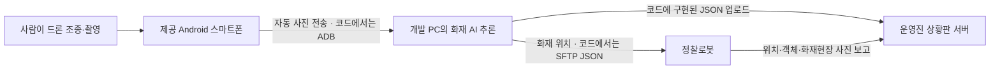

# 2025 국방 AI 경진대회: 대회 자료·코드·멘토링 Q&A 통합 정리

> 사전교육 PDF 23쪽, 코드 ZIP 3개, 첨부 엑셀 `maicon_qa.xlsx`의 질문 27건·답변/댓글 28건·공지 1건·본문 이미지 1장을 대조한 자료입니다. 공식 사전 안내, 운영진 답변, 코드에서 관찰한 사실, 분석자의 추정을 구분합니다. 최종 현장 규정이나 실제 대회 성적을 대신하는 문서는 아닙니다.

## 1. 출처와 읽는 방법

| 표기 | 자료 | 범위·시점 |
|---|---|---|
| PDF | [2025 국방 AI 경진대회 사전교육자료](./prestudy%281%29_2025MAICON%281%29.pdf) | 23쪽. 메타데이터 작성일 2025-10-28. 쪽수는 PDF 페이지 기준 |
| Q01~Q27 | `maicon_qa.xlsx`, `Q&A` 시트 | 질문 작성일 2025-11-03~11-17, 답변은 11-18까지 포함. 엑셀 기재 수집일 2026-10-28 |
| 공지 | 엑셀 `자료` 시트 | 2025-10-20 게시판 이용 안내, 게시글 ID 111 |
| 드론 ZIP | [TalkFile_MAICON-2025-drone-main.zip](https://github.com/jha68/MAICON/releases/download/source-files/TalkFile_MAICON-2025-drone-main.zip) | 화재 인식 실험, 사진, ROI 도구, 모델·학습 관련 파일 |
| 통합 ZIP | [TalkFile_maicon-main.zip](https://github.com/jha68/MAICON/releases/download/source-files/TalkFile_maicon-main.zip) | 화재 추론, ADB 사진 수집, SFTP/HTTP 전송 |
| 주행 ZIP | [TalkFile_the_last_drive_maicon-main.zip.zip](./TalkFile_the_last_drive_maicon-main.zip.zip) | 주행 Python 파일 1개, 노트북 2개 |

- Q 번호는 엑셀의 `번호` 열입니다. 부록에서 원문 링크·질문 작성일·답변 날짜와 전체 질의응답을 확인할 수 있습니다.
- Q&A는 첨부 엑셀에 수록된 운영진 답변의 스냅샷입니다. 연결된 웹 게시글의 현재 내용까지 다시 검증한 것은 아닙니다.
- 질문자의 가정·예시·전해 들은 내용은 운영진이 확인한 사실로 취급하지 않습니다. 답변이 일부만 다룬 경우 미확인 부분을 남깁니다.
- PDF 이후의 Q&A가 구체화한 부분을 함께 반영하되, 명시되지 않은 배점·규격·동작을 임의로 확정하지 않습니다.
- 코드와 모델은 팀의 구현 자료이며 대회 규칙이 아닙니다. 파일 누락은 당시 미구현을 증명하지 않습니다.
- 원본 PDF·ZIP은 변경하지 않았습니다. 엑셀 자체와 개인 질문자 이름은 이 문서에 재배포하지 않으며, 필요한 질문·답변 내용과 출처를 수록합니다.
- 첨부 엑셀 SHA-256: `34663dbe033d3149b73e3d709efaa38b910929cfd7083d6e9a4d0f611abf3793`.

## 2. Q&A로 추가 확인되거나 구체화된 핵심 사항

| 항목 | 통합 결론 | 근거 |
|---|---|---|
| 화재건물 수 | 전체 9개 중 **2개**. 로봇이 두 건물 모두 위치를 식별하고 촬영해야 하며 각각 개별 점수 | [Q18](#q18), PDF 14·19쪽 |
| 체크포인트 순서 | Alpha·Bravo·Charlie의 **통과 순서는 정해져 있지 않음** | [Q05](#q05) |
| ArUco 사용 | 위치 인식 보조 수단이며 **사용은 선택 사항**. 전부 사용할 의무 없음 | [Q14](#q14) |
| 촬영 이후 자동화 | 평가 중 사람이 수행할 수 있는 단계는 드론 원격 조종·촬영이며, 이후 사진 전송과 화재 위치 AI 추론은 자동화 | [Q04](#q04) |
| 상황판 서버 | 운영진이 설치·관리. 접속·전송 방식은 입소식에서 안내 예정 | [Q19](#q19) |
| 통신보고 횟수 | **정확히 4회라는 답변이 아님.** 전송할 정보 4종과 각 기한을 안내 | [Q26](#q26) |
| 객체 인식 시점 | 정지 상태와 주행 중 인식 모두 허용. 자율 탐지 후 목적지 도착 전 서버 전송 | [Q16](#q16) |
| 객체 평가 결과 | 목적지 도착까지 최종 보고된 대시보드의 종류·수량 결과로 평가 | [Q25](#q25) |
| 객체 수·중복 | 구역별 개수는 고정되지 않으며 같은 종류가 중복될 수 있음 | [Q22](#q22), [Q23](#q23) |
| 시험 기회 | 연습장 4개 운영 예정, 평가장 사용 기회는 약 1~2회 예정. 무제한 사용을 확인한 답변은 아님 | [Q01](#q01) |
| 장소 | 본선 장소가 **YBM 연수원**임을 확인. 구체적인 주소는 첨부 자료에 없음 | [Q27](#q27) |

## 3. 대회 개요와 평가

### 3.1 기본 정보

| 항목 | 내용 |
|---|---|
| 대회 | 2025 국방 AI 경진대회 본선 |
| 표어 | 오늘의 도전, 내일의 국방 |
| 주제 | MUM-T 기반 전장 환경 위험 탐지 및 통합 관제 체계 |
| MUM-T | 유무인 복합 운용체계, Manned-Unmanned Teaming |
| 주최 | 대한민국 국방부 |
| 주관 | 정보통신기획평가원(IITP), 한국오픈소스협회(KOSSA) |
| 후원 | 한화에어로스페이스, 클로봇, 모아소프트, 펀진, 큐브리드, 모라이 |
| 본선 장소 | YBM 연수원 — Q27 |
| 운영 문의 | 자료 기재 기준 `02-6736-7419`, `contact@maicon.kr` |

근거: PDF 1·4·23쪽, Q27. 정확한 개최일·주소·참가팀 수·상금·수상 결과는 확인되지 않습니다. Q01 질문의 ‘2박 3일’ 표현도 운영진 답변이 기간을 명시적으로 확인한 것은 아닙니다.

### 3.2 임무 구성

| 영역 | 임무 | 요구되는 행동 |
|---|---|---|
| 자율주행 | 구간주행 | 출발~도착 구간에서 Alpha·Bravo·Charlie 체크포인트 통과 |
| 자율주행 | 정찰시간 | 출발 신호부터 도착까지의 총시간으로 순위 산정 |
| 객체인식 | 아군표식 | QR코드를 인식하고 로봇 LED에 패턴 표시 |
| 객체인식 | 장애물 회피 | 포트홀 등 장애물을 인식하고 회피 |
| 객체인식 | 정찰탐지 | 구역별 객체의 종류·수량을 탐지·분류·집계하고 서버 보고 |
| 통신보고 | 화재건물 파악 | 드론 사진을 PC에서 AI 추론해 화재건물 위치를 로봇에 전달 |
| 통신보고 | 화재현장 보고 | 로봇이 화재건물 2곳으로 이동해 각각 촬영하고 서버 전송 |
| 통신보고 | 위치보고 | 체크포인트 통과 정보를 서버에 전송 |

근거: PDF 4~6·9·12~15쪽, Q18·Q26. QR은 피아식별용, ArUco는 위치 인식 보조용으로 서로 다른 요소입니다(Q06·Q13·Q14).

### 3.3 배점과 평가 방식

| 평가 항목 | 배점 | 내용 |
|---|---:|---|
| 발표: 문제 이해도 | 8점 | 문제 해결 논리 구조의 명확성 |
| 발표: 모델 완성도 | 8점 | 알고리즘 선정·모델 구축 전략의 타당성 |
| 발표: 발표 및 답변 | 4점 | 전달력·답변의 적절성 |
| 임무평가 | 80점 | 자율주행·객체인식·통신보고 정량평가 |
| 합계 | **100점** | 발표 20%, 임무 80% |

- 임무평가는 총 2회 실시하고 고득점을 기준으로 최종 점수를 산정합니다. 회차별 점수를 항목별로 조합하는지 등의 세부 산식은 확인되지 않습니다.
- 체크포인트 통과에 따라 점수를 누적하며, 출발~도착 총시간으로 정찰시간 순위를 산정합니다.
- 객체 종류·수량은 목적지 도착까지 최종 보고된 대시보드 결과로 평가합니다(Q25).
- 화재건물 2개는 각각 개별 점수입니다(Q18).
- 임무 80점의 세부 종목별 배점, 제한시간, 재주행 감점량, 동점 처리 방식은 자료에 없습니다. PDF는 세부 종목이 조정될 수 있고 배점은 오리엔테이션에서 공개한다고 안내합니다.

근거: PDF 8~14쪽, Q17·Q18·Q25.

## 4. 경기장·마커·객체

### 4.1 경기장 구성

| 항목 | 내용 | 근거 |
|---|---|---|
| 전체 크기 | 가로 5m × 세로 3.5m | PDF 19쪽 |
| 구간 | 출발/도착, 직진, 교차로, 곡선, 장애물 구간 | PDF 19쪽 |
| 체크포인트 | Alpha, Bravo, Charlie의 3곳 | PDF 19쪽, Q23 |
| 건물 | Sector 1~9, 위치 고정 | PDF 19쪽 |
| 화재 | 9개 건물 중 2개, 화재건물은 경기 당일 임의 지정 | PDF 15쪽, Q18 |
| 객체 배치 지점 | Object Position 23곳 | PDF 19쪽 |
| 객체 종류 | 미사일, 위험물, 박격포, 전차, 적군, 탄약상자, 자동차의 7종 | PDF 19쪽 |
| 포트홀 | 평가 대상 2곳, 위치 고정 | PDF 19쪽, Q12 |
| 차도 폭 | 약 340mm, 직선·곡선에서 다를 수 있음 | Q20 |
| 차선 규격 | 답변 원문은 ‘약 50T’. 단위·의미를 임의로 50mm로 환산하지 않음 | Q20 |

‘체크포인트 3곳’, ‘객체 배치 지점 23곳’, ‘건물 9개’는 서로 다른 개념입니다. 23곳이라는 수치가 실제 객체 수 23개를 뜻하지 않습니다.

코드가 사용하는 상대적 건물 배치는 아래와 같습니다. 사진 방향이 지도와 대체로 일치한다는 가정 아래 사용하는 매핑이며, 실제 거리 비율을 나타내지 않습니다.

```text
위쪽:    S1    S2          S3    S4
중간:          S6          S5
아래쪽:  S7    S8          S9
```

### 4.2 ArUco와 QR

- ‘아루코 코드’와 ‘아루코 마커’는 같은 의미이며 공식 명칭은 ArUco marker입니다(Q13).
- Q13은 ArUco가 바닥에 존재한다고 설명합니다. Q10·Q14는 교차로와 건물 앞 등 로봇 시야 안의 중요한 지점에 설치한다고 구체화합니다.
- ArUco의 개수·위치는 난이도와 현장 구성에 따라 바뀔 수 있습니다. 테두리 색상도 고정값으로 공개되지 않았습니다(Q11·Q14).
- 차선 정중앙에 있다는 보장은 없습니다(Q10).
- ArUco는 필수 사용 요소가 아니며, 활용 여부·방식은 팀 전략에 달려 있습니다(Q14).
- 피아식별 QR은 별도 표지판 형태입니다. 다른 모형에는 별도 QR이 없다고 답변했습니다(Q06).
- 운영진은 차선과 마커의 구분 방법으로 형태 기반 필터링·마스킹 등을 제시했지만, 특정 알고리즘을 의무화하지 않았습니다(Q11).

### 4.3 객체 배치·인식·집계

- 개수는 정해져 있지 않고 같은 종류가 중복될 수 있습니다(Q22).
- 종류·개수는 임의로 정합니다. Q23의 ‘한 배치 지점에 한 종류만 놓이는가’라는 질문을 답변이 그대로 확인한 것은 아닙니다.
- Q17 답변은 ‘모든 객체는 단일 객체로 배치’한다고 명시합니다. 같은 종류가 여러 개 존재할 수 있다는 Q22와 다른 개념이며, 모든 시점에서 가림이 없다고까지 보장하지는 않습니다.
- Q03은 객체가 로봇 카메라 시야 안에 있으며, 별도의 초록색 표식 없이 ‘주행 라인에 위치’한다고 설명합니다. 이 표현만으로 모든 객체를 주행을 막는 장애물로 해석하지 않습니다.
- 정지해서 인식하거나 주행 중 인식하는 방식 모두 허용됩니다. 자율적으로 탐지하고 목적지 도착 전 서버에 보고해야 합니다(Q16).
- 한 화면에 다른 지점의 객체도 들어오는지에 대한 Q08은 명확한 예/아니오 답변이 없습니다. 유효시야 정의에 따라 처리 방식이 달라진다는 설명입니다.
- 경로는 자유지만 구역별 종류·수량 결과의 정확도가 평가됩니다(Q05·Q17·Q25). 경로 변경 시 구역 귀속·중복 집계 처리의 세부 규격은 별도 확인이 필요합니다.

### 4.4 포트홀

- 평가 대상 위치는 2곳으로 고정됩니다(Q12).
- 연습장과 평가장 포트홀의 위치·크기·재질이 같다고 답변했습니다(Q07). 질문에 포함된 배치각도까지 완전히 같다고 명시한 답변은 아닙니다.
- 주변에 우회 공간이 있어 직접 밟지 않고 회피할 수 있습니다. 반드시 유턴해 다른 길을 선택해야 한다는 규정은 아닙니다(Q15).
- 회피 중 주변 건물·객체를 파손하면 인정하지 않는다고 PDF가 안내합니다(PDF 15쪽).

## 5. 자동화와 통신보고

### 5.1 공식 요구와 코드의 연결 구조



- Q04는 실제 평가에서 드론 원격 제어·촬영 이후 사진 전송과 화재 위치 AI 추론이 모두 자동화되어야 한다고 명시합니다. 사람이 수동으로 사진을 옮기거나 화재 섹터를 입력하는 방식의 허용 근거는 없습니다.
- 서버는 운영진이 설치·관리합니다. 팀이 자체 상황판 서버를 구축해야 한다는 요구는 없습니다(Q19).
- 공식 통신보고는 로봇→서버로 안내됩니다(Q26). ZIP에는 PC가 서버로 직접 JSON을 보내는 경로도 있습니다. 이것이 공식 로봇 보고 요구를 대체해도 되는지는 확인되지 않습니다.
- 로봇이 촬영한 화재 사진은 로컬 보관만으로 끝나지 않고 서버로 전송해야 합니다(Q26).

### 5.2 보고 정보와 기한

| 보고 정보 | Q26에 명시된 방향 | 기한 |
|---|---|---|
| 임무 코드 | 로봇 → 서버 | 출발 전 |
| 지정 포인트 통과 정보 | 로봇 → 서버 | 다음 포인트 도착 전까지 |
| 화재건물 이미지 | 로봇 → 서버 | 마지막 지점 도착 전 |
| 구역별 객체 종류·수량 | 로봇 → 서버 | 마지막 지점 도착 전 |

Q26의 번호 1~4는 정보의 종류이며, 업로드를 정확히 4번만 해야 한다는 의미가 아닙니다. 체크포인트 순서가 자유이므로 고정된 Alpha→Bravo→Charlie 순서만 가정하지 않아야 합니다. Q25는 목적지 도착까지 최종 보고된 대시보드 결과로 평가한다고 설명합니다. 재전송·누적·덮어쓰기 동작과 통신 API 세부 사항은 입소식 안내 대상입니다.

### 5.3 ZIP에서 확인한 보고 형식

| 필드 | 코드상 의미 |
|---|---|
| `mission_code` | 임무 코드. 구현에 `2W9G`가 반복되지만 팀명·팀원 확인 근거는 아님 |
| `fire_buildings` | 화재 섹터 목록, 예: `sector2` |
| `points` | 통과 체크포인트 목록 |
| `detection.Alpha`, `Bravo`, `Charlie` | 구역별 객체 목록 |
| 객체의 `type`, `count` | 클래스와 집계 수량 |

- JSON 업로드 예제 경로: `/dashboard_json`.
- 사진 업로드 예제 경로: `/img/dashboard/fire_building`.
- 사진명 예제: `####_sector#.jpg`. 공식 필수 파일명 규칙이라고 확정할 근거는 없습니다.
- 객체 타입 예제에는 `hazmat`, `enemy`, `tank`, `mortar`, `box`, `box2`, `ammo`, `ammo2`가 있습니다. PDF의 7종 클래스와 대응하는 공식 매핑표는 포함되지 않았습니다.
- Q19 자료 시트의 본문 이미지는 PDF의 통신보고 설명을 발췌한 것으로, 추가 API 명세나 별도 채점표는 아닙니다.

근거 코드: 통합 ZIP `filerecvsender.py`, `fire_detection.py`, `dummy_data/jetson/sendjson.ipynb`, `sendimage.ipynb`, `startdashboard.ipynb`.

## 6. 연습·운영·생활 규정

### 6.1 경기장 이용과 데이터 수집

- 연습용 경기장 4개를 운영할 예정이며 입소식에서 안내할 이용 규칙을 따릅니다(Q01).
- 평가용 경기장 사용은 별도 제한된 기회로 약 1~2회 예정이라고 답변했습니다. 이를 실제 확정 배정 횟수나 무제한 촬영으로 해석하지 않습니다(Q01).
- 연습장과 평가장은 기간 중 육안으로 볼 수 있도록 개방 예정입니다. 평가장을 사용할 수 있는 시간은 별도로 제한됩니다(Q02).
- 건물·도로 등 디오라마의 형태를 임의로 바꿀 수 없습니다. 과제 수행·연습 이용 문맥에서 화재 디오라마와 객체 모형 위치는 변경 가능하다고 답변했습니다(Q01). 평가 도중 임의 변경 허용을 뜻하지 않습니다.
- 로봇 카메라로 사진·영상을 촬영해 개발 노트북으로 전송할 수 있습니다(Q24).
- 테스트용 객체 모형은 본선과 같고, 객체인식 데이터셋·라벨링 데이터는 별도로 제공되지 않습니다(PDF 15쪽).

### 6.2 장비·소프트웨어·공정성

- 카메라·모터·배터리·센서·제어기 등 제공 하드웨어를 임의 교체·분해·개조할 수 없습니다(PDF 11쪽).
- 소프트웨어 추가 구성·수정·보완은 가능합니다(PDF 11쪽).
- PDF 원문은 ‘가상환경 및 클라우드 기반 환경 사용은 보안 및 공정성 확보를 위해 제한’한다고 설명하고, 생성형 AI 도구 활용, 자료 열람·데이터 활용, 데이터 라벨링 플랫폼 활용은 가능하다고 안내합니다. 적용 범위를 임의로 일반화하지 않습니다.
- 다른 팀과 데이터 공유·장비 교환·기술 협력을 금지하며 위반 시 실격한다고 안내합니다(PDF 11쪽).
- 드론은 제공 Android 스마트폰과 공식 앱만 사용합니다. 자동 피사체 추적·AI 기능 사용은 금지합니다(PDF 15·18쪽). 별도 컨트롤러는 제공하지 않습니다(Q21).
- 로봇과 드론의 출발 시점은 팀 전략에 따라 정할 수 있습니다(PDF 15쪽).
- 심사위원 신호에 따라 팀원 한 명이 출발 버튼을 누르며, 도착 시간은 자동 센서로 기록합니다(PDF 15쪽).
- 정상 상태의 로봇이 주행 불능이 된 경우 체크포인트로 옮겨 재주행하는 비상복귀를 1회 허용하고 감점합니다. 경과 시간은 계속 누적됩니다(PDF 12·15쪽).

### 6.3 YBM 연수원과 문의 채널

- 카페·매점을 운영하며, 매점은 07:00~22:00 이용 가능하고 간단한 일회용품을 구매할 수 있습니다(Q27).
- 연수원 외부와 특정 오락 시설의 출입을 제한합니다. 시설 내 흡연·간단한 산책은 허용됩니다(Q27).
- 비상사태·건강 문제·긴급 사유의 외부 출입은 현장 운영사무국에 알리도록 안내합니다(Q27).
- 게시판은 사전 학습·멘토링 질의응답 채널이며, 운영 문의는 전화·이메일 전용 채널로 안내합니다(공지).
- 답변은 주말·공휴일을 제외하고 24시간 이내 예정이며, 본선 과제의 직접적인 힌트는 답변이 제한될 수 있습니다(공지).
- 댓글 등록 오류는 2025-11-06 답변 시점에 해결 완료가 확인되지 않았습니다. 긴급 문의는 전화·이메일 또는 새 글 작성을 사용하도록 안내했습니다(Q09).

## 7. 장비와 소프트웨어

### 7.1 공식 장비 사양

| 구분 | 사양 — PDF 17~18쪽 |
|---|---|
| 로봇 크기·무게 | 210 × 270 × 180mm, 2.5kg |
| AI 보드 | NVIDIA Jetson Nano Developer Kit, Cortex-A57 쿼드코어, 4GB 메모리, microSD 64GB |
| 로봇 카메라 | IMX219, 8MP, CSI |
| 모터·제어기 | 12V DC 기어드 엔코더 모터, 최대 140rpm, STM32 Cortex-M0, IMU |
| LED·디스플레이 | WS2812 8개 구성 2세트, 4×4 LED 1개, 1.3인치 I²C OLED |
| 로봇 배터리·시간 | 12V 6700mAh, 작동 약 3시간, 충전 약 5시간 |
| 기구 재질 | 전차 Metal, 무한궤도 Carbon Steel — PDF 표기 |
| 드론 구성 | DJI Neo 1대, 배터리 2개, 충전 케이블, Android 스마트폰 |
| 드론 크기·무게 | 130 × 157 × 48.5mm, 약 135g |
| 비행시간 | 약 15분 — 자료 기준 |
| 드론 카메라 | 1/2인치 센서, 시야각 117.6°, JPEG 12MP |
| 짐벌·조종 | 1축 전동 틸트 짐벌, 스마트폰 공식 앱 |

### 7.2 공식 소프트웨어 안내

| 환경 | 안내된 구성 — PDF 21~22쪽 |
|---|---|
| 로봇 OS·언어 | Ubuntu 18.04, Python 3.8 |
| NVIDIA SDK | JetPack 4.6.1 |
| 로봇 딥러닝 | PyTorch 1.11.0, TorchVision 0.12.0 |
| 로봇 영상·추론 | OpenCV 4.9.0, Ultralytics 8.3.20, YOLOv8n |
| 로봇 개발 도구 | JupyterLab 4.2.5, WingBot Robot API |
| PC — 선택사항 | Windows 10 Pro 이상, Python 3.11.4, VS Code |
| PC 추론·라벨링 | Ultralytics 8.3.23, YOLOv8n, labelImg 1.8.1 |

PC와 로봇은 AP를 통한 WLAN 연결을 사용합니다. PC에서 라벨링·학습을 하고 브라우저로 로봇 JupyterLab에 접속하는 구성이 안내되어 있습니다.

ZIP의 실제 주행 코드는 `tiki.mini.TikiMini`를 사용하고, 화재 모델 저장 버전은 Ultralytics 8.3.229입니다. 공식 사전 안내와 실제 개발 파일의 차이는 확인되지만, 변경 경위나 최종 장비 구성은 확인되지 않습니다. 클라우드에서 검증한 Python 3.12·CPU 환경도 공식 Jetson 환경과 구분해야 합니다.

## 8. 코드와 모델에서 확인한 구현

### 8.1 ZIP별 구성

| ZIP | 파일 구성과 역할 |
|---|---|
| 드론 ZIP | 파일 63개: JPG 48개, Python 6개, 모델 2개 등. ROI 지정·화재 인식 실험·학습 관련 파일 |
| 통합 ZIP | 파일 59개: JPG 40개, Python 8개, 모델 3개, 노트북 3개, Windows 실행파일·PyInstaller 설정 등 |
| 주행 ZIP | Python 1개, 노트북 2개 |

사진 수에는 원본·처리 이미지·디버그 결과가 섞여 있습니다. 드론 ZIP의 `training/raw_images`에는 JPG 40장이 있으며 전체 48장을 학습셋 크기로 단정하지 않습니다.

### 8.2 사진 수집·파일 전달

통합 ZIP의 `filerecvsender.py`는 스마트폰 `/sdcard/DCIM/DJI Album`을 ADB로 감시합니다. 초기 파일을 제외하고 새 파일을 약 3초 간격으로 찾아 `local_inbox`에 복사하며, 임시 파일을 완성 파일명으로 바꿉니다. `ai_outbox`의 임무코드 JSON을 Jetson으로 SFTP 전송하고 상황판으로 HTTP 업로드합니다. Jetson 접속 설정값은 이 문서에 재현하지 않습니다.

Windows 실행파일과 PyInstaller 설정이 있어 Windows PC가 사진 수집·추론·전송을 중계하고 Jetson이 로봇 제어를 맡는 구성을 사용하려 했다고 해석할 수 있습니다. 실제 전체 연결 성공 기록은 확인되지 않습니다.

### 8.3 화재 인식

- 샘플 사진과 디버그 결과에서는 건물의 붉은 표식 중 밝게 점등된 표식을 화재로 구분합니다. 실제 화염·연기 검출 성능으로 해석할 근거는 없습니다.
- 최상위 `fire_detection.py`는 YOLO 신뢰도 0.25, 이미지 크기 640으로 추론합니다.
- 건물에 대응하는 탐지가 **정확히 9개**일 때만 세로 순으로 4·2·3개 묶고, 각 묶음을 가로 정렬해 `1,2,3,4,6,5,7,8,9` 섹터에 대응시킵니다.
- 화재 섹터 JSON과 디버그 이미지를 저장하고 입력을 `processed`로 이동합니다.
- 방향·구도·가림·중복 검출에 따라 9개 매핑이 깨질 수 있다는 점은 알고리즘 구조에서 도출되는 한계입니다.
- 이전 로컬 검증에서 포함 사진 `drone_20251120151934.jpg`의 9개 표식과 화재 섹터 `sector1`, `sector9`를 출력했습니다. JSON·디버그 이미지·처리 파일 이동을 확인했지만 이는 한 샘플의 기능 검증입니다.

다른 실험에는 마우스 ROI 지정, 붉은 픽셀 비율·평균 밝기에 의한 라벨 생성, ROI 분류 학습, 원본·밝기 강조·흰색/검은색 마스크·대비 강화의 5개 영상 추론과 투표가 있습니다. `train_fire.py`는 비어 있고 `train_fire.ipynb`에는 셀이 없습니다. 분류 학습 설정 파일이 있다는 사실만으로 학습 완료를 증명할 수는 없습니다.

### 8.4 모델 메타데이터

| 모델 위치 | 기반·클래스 | 학습 설정 | 저장된 mAP50 / mAP50–95 |
|---|---|---|---|
| 드론 ZIP `best.pt` | YOLOv8n, `fire` / `non-fire` | 30 epochs, batch 16, imgsz 640 | 0.995 / 0.58658 |
| 통합 ZIP `best.pt` | YOLO11s, `fire` / `non-fire` | 100 epochs, batch 16, imgsz 640 | 0.995 / 0.65973 |
| 통합 ZIP `dummy_data/best1.pt` | YOLOv8n, `fire_building` / `normal_building` | 30 epochs, batch 16, imgsz 640 | 0.995 / 0.80915 |
| 드론 ZIP `yolov8n-cls.pt` | YOLOv8n 분류, 1,000개 클래스 | 기존 사전학습 모델 | 화재 전용 성능 아님 |

통합 ZIP `dummy_data/best.pt`는 드론 ZIP `best.pt`와 SHA-256이 같습니다. 화재 모델은 Ultralytics 8.3.229로 저장됐고 저장 날짜는 메타데이터상 2025-11-20입니다. 지표는 저장된 검증 결과이며 독립 재평가 결과가 아닙니다. 동일 데이터 분할 여부를 알 수 없어 모델 우열을 단정할 수 없습니다.

### 8.5 로봇 주행

`auto_drive_tiki_sj.py`는 Jetson CSI 카메라 영상을 GStreamer로 받고, 원근변환 → HLS 흰색 중앙선 추출 → 슬라이딩 윈도우 → 2차 곡선 추정 → 좌우 모터 조향 순서로 주행합니다. 교차로 판정 시 일정 프레임 직진하고, ArUco 동작과 YOLO ONNX 탐지·대시보드 보고 모듈을 호출합니다.

노트북 `change_drive.ipynb`와 `lagacy_drive.ipynb`의 코드 내용은 동일하지만 저장된 출력은 다릅니다. 전자에는 Jetson 카메라 연결·촬영 로그가 있고 후자에는 `ipywidgets` 누락 오류가 있습니다. 카메라 실행 흔적이며 완주 성공 기록은 아닙니다.

## 9. 공식 요구 대비 구현 공백과 확인된 한계

| 요구사항 | ZIP에서 확인한 상태 |
|---|---|
| 화재 사진 추론 | 코드·모델·샘플·출력 존재, 한 샘플 기능 검증 완료 |
| 촬영 이후 자동 사진 전달 | ADB 감시·복사 코드 존재, 실기기 종단 간 검증은 미수행 |
| 화재 위치 전달 | SFTP·HTTP 전송 코드 존재 |
| 차선 추종 | 영상처리·모터 제어 코드 존재 |
| ArUco 위치·동작 | 호출부는 있으나 구현 모듈 누락. 대회에서는 사용 자체가 선택 사항 |
| QR 피아식별·LED | 주행 Python 파일에 ‘QR 기능 모두 제거’라고 명시. 공식 QR 임무의 폐지를 뜻하지 않음 |
| 로봇 객체 인식·집계 | ONNX 로딩·통신 호출부가 있으나 모델과 핵심 모듈 누락 |
| 두 화재건물 방문·촬영·보고 | 이미지 전송 예제는 있지만 두 건물 전체 자동 수행을 확인할 수 없음 |
| 포트홀 회피 | 제공 파일만으로 완성된 독립 구현을 확인할 수 없음 |
| 공식 보고 기한·최종 상황판 결과 | 실제 서버와 연결한 경기 기록이 없어 충족 여부 확인 불가 |

누락 파일: `aruco_tag_action_tiki.py`, `aruco_tag_action_tiki_final.py`, `yolo_inference.py`, `dashboard_comm.py`, `yolo/best.onnx`. `tiki` SDK도 ZIP에 포함되지 않았습니다. 당시 별도 장치나 파일에 구현이 있었을 가능성은 남아 있습니다.

소스에서 확인한 주의점은 다음과 같습니다. 실제 경기 사고로 확인한 기록은 아닙니다.

1. 탐지 수가 9개가 아니어도 사진은 처리 폴더로 이동할 수 있어, ‘처리됨’이 JSON 보고 성공을 의미하지 않습니다.
2. 일부 실험본의 `"fire" in 클래스명` 조건은 `non-fire`도 포함합니다. 최상위 통합본은 정상 클래스를 제외하지만 변형본마다 동작이 다릅니다.
3. 파일 전송 코드가 성공 여부와 무관하게 JSON 삭제 단계로 진행할 수 있습니다. 최종 대시보드 결과가 채점 대상이라는 Q25와 함께 검토해야 합니다.
4. 최상위 주행 파일은 차선을 찾지 못한 분기에서 모터 정지 호출 없이 반환합니다.
5. 교차로 판정 전에 `prev_xs`를 현재 값으로 갱신해 이전 프레임 비교 의도가 실현되지 않는 부분이 있습니다.
6. PC 직접 보고 경로를 공식 로봇→서버 보고와 동일하게 인정하는지 자료에 없습니다.

## 10. 자료를 바탕으로 한 준비·검증 관점

아래는 공식 규정이 아니라 자료에서 도출한 개발상의 판단입니다.

- 고정 지도와 자유로운 체크포인트 순서를 함께 고려해 이동 경로와 두 화재건물 방문 순서를 설계할 수 있습니다. 보고는 실제 방문 순서를 반영해야 합니다.
- 모델 정확도뿐 아니라 자동 전송, 재시도, 구역별 중복 집계, 마감 전 최종 상황판 반영을 검증해야 합니다.
- 데이터셋이 제공되지 않으므로 실제 로봇·드론 촬영을 통한 데이터 확보가 중요합니다. 평가장 사용 기회가 제한되므로 연습장을 활용한 준비가 필요합니다.
- 사진 구도·표식 밝기에 대한 안정성이 필요합니다. Q18의 ‘화재 2개’ 규칙을 알고 있다는 사실만으로 탐지 없이 임의의 두 섹터를 고르는 방식을 정당화할 수는 없습니다.
- 정지 인식이 허용되므로 정확도와 총 수행 시간 사이의 선택이 가능합니다. 공식 제한시간과 종목 배점을 알아야 구체적 전략을 비교할 수 있습니다.
- ArUco가 선택 사항이어도 별도의 QR 임무는 남아 있습니다. 두 기능을 함께 생략해도 된다고 해석하지 않습니다.
- PC 학습 환경과 Jetson 추론 환경의 버전·모델 형식·하드웨어 차이를 확인해야 합니다.
- 발표 20점에는 논리 구조와 모델 선정 전략이 포함됩니다. 선택 이유, 검증 결과, 실패 상황과 대응을 설명할 근거가 필요합니다.

## 11. 미확인 사항과 해석 경계

- 정확한 개최일·연수원 주소·기간·팀 구성·참가팀 수·상금·수상 결과.
- 임무 세부 배점·재주행 감점량·제한시간·동점 처리·2회 점수의 세부 산정 방식.
- 최종 마커 ID·개수·테두리·위치, 차선 ‘50T’의 정확한 의미.
- 배치 지점마다 한 종류만 놓는지, 모든 시점에서 가림이 없는지, 연습·평가 포트홀 배치각도까지 동일한지.
- 경로가 달라졌을 때 구역별 집계의 정확한 경계, 서버 누적·덮어쓰기·중복 제거 방식, 최종 클래스 매핑과 API.
- PC의 직접 상황판 업로드가 공식 로봇 보고 요구를 대체할 수 있는지.
- 전체 학습셋·정답 라벨·데이터 분할, 실제 완주 시간·성공률·최종 점수.
- 2025-11-20 모델 저장 기록과 11-20~21 사진 파일명은 작업 시점을 시사하지만 공식 개최일의 증거로 삼지 않습니다.

## 12. Q&A 전체 출처와 원문

아래에는 엑셀 번호 순으로 27개 질문과 28개 답변/댓글을 수록합니다. 질문자 이름은 제외했습니다. 인용문의 오탈자·질문 속 가정은 원문대로 보존하며, 위 본문의 정리와 구분해서 읽어야 합니다. 작성 시각은 엑셀 표기 기준이고 시간대는 원본에 명시되어 있지 않습니다.

<a id="q01"></a>

### Q01. 실제 테스트 환경(화재 디오라마 포함)은 드론으로 촬영할 기회가 무제한으로 주어자나요?

- 질문 작성일: 2025-11-03
- 게시글 ID: 115
- 답변/댓글: 1건
- [게시글 원문](https://maicon.kr/%EB%A9%98%ED%86%A0%EB%A7%81/?pageid=3&kboard_id=5&view_iframe=1&iframe_id=6ae1ab5ea62d9&mod=document&uid=115)

<details>
<summary>질문 및 답변 원문 보기</summary>

**질문**

> 안녕하세요, 문의 사항이 있어 질문글 올립니다.
>
> 실제 테스트 환경(화재 디오라마 포함)은 드론으로 촬영할 기회가 무제한으로 주어자나요? 또한, 촬영을 위해 실제 테스트 환경의 화재 디오라마 형태와 화재 건물을 본선 기간 2박3일 전체 기간 동안 다양하게 조작해도 되나요?
>
> 감사합니다.

**답변·댓글 전체**

> [1] 익명 (2025-11-04 17:59)
> 안녕하세요.
> 국방 AI 경진대회 운영사무국 입니다.
>
> 과제 수행 기간 동안에는 연습용 경기장을 활용 할 수 있습니다.(연습용 경기장 총 4개 운영 예정)
> 연습용 경기장은 정해진 규칙에 따라 이용이 가능하며, 이용 규칙은 입소식에서 안내될 예정입니다.
> 연습용 경기장 외에도 실제 평가에 사용되는 평가용 경기장은 별도 제한된 사용 기회를 제공할 예정입니다.(약 1~2회 정도)
>
> 연습용 경기장 및 평가용 경기장의 디오라마(건물 및 도로등) 형태는 임의로 변경이 불가합니다. 단, 화재 디오라마 및 객체 모형의 위치는 변경 가능합니다.
>
> 감사합니다.
>
> 운영사무국 드림

</details>

<a id="q02"></a>

### Q02. 실제 테스트 세트장은 테스트 주행 가능 시간 외에도 외부에서 볼 수 있게 되어있나요?

- 질문 작성일: 2025-11-03
- 게시글 ID: 116
- 답변/댓글: 1건
- [게시글 원문](https://maicon.kr/%EB%A9%98%ED%86%A0%EB%A7%81/?pageid=3&kboard_id=5&view_iframe=1&iframe_id=6ae1ab5ea62d9&mod=document&uid=116)

<details>
<summary>질문 및 답변 원문 보기</summary>

**질문**

> 안녕하세요, 문의사항이 생겨 질문드립니다.
>
> 실제 테스트 세트장은 테스트 주행 가능 시간 외에도 외부에서 볼 수 있게 되어있나요? 혹시 실제 테스트장 주행 가능 시간이 아닐 땐 천 같은 것으로 가려져 있는건가요?
>
> 감사합니다.

**답변·댓글 전체**

> [1] 익명 (2025-11-04 18:01)
> 안녕하세요.
> 국방 AI 경진대회 운영사무국 입니다.
>
> 평가용 경기장과 연습용 경기장은 대회 기간 동안 항시 육안으로 확인이 가능하도록 개방 될 예정입니다. 단, 평가용 경기장은 지정된 시간 외에는 사용이 제한됩니다.
>
> 감사합니다.
>
> 운영사무국 드림

</details>

<a id="q03"></a>

### Q03. 정찰탐지 평가를 위한 객체 위치 관련 문의드립니다.

- 질문 작성일: 2025-11-03
- 게시글 ID: 117
- 답변/댓글: 1건
- [게시글 원문](https://maicon.kr/%EB%A9%98%ED%86%A0%EB%A7%81/?pageid=3&kboard_id=5&view_iframe=1&iframe_id=6ae1ab5ea62d9&mod=document&uid=117)

<details>
<summary>질문 및 답변 원문 보기</summary>

**질문**

> 안녕하세요, 정찰탐지 평가를 위한 객체 위치에 관한 질문이 생겨 이렇게 문의드립니다.
>
> 정찰탐지 평가에선 특정 지점에서 객체의 개수와 종류를 판단할 수 있는지에 대한 여부를 본다고 되어있습니다. 그렇다면 이 객체들은 작년 대회 유튜브 영상에 있는 것처럼, 특정 지점의 "차도 옆"에만 위치하는건가요? 처음엔 전차가 차도를 따라가면서 발견되어야하기에 차도 위에 존재한다고 생각했는데, 그러면 정찰탐지가 아니라 장애물회피에 포함될 것 같아 작년 대회처럼 차도 옆에 객체들이 존재하고, 각 객체들의 위치를 표시하기 위해 차도에 작년 대회의 초록색 표시 같은 것들이 있을 것 같다고 생각했습니다. 
>
> 또한 만약 특정지점의 "차도 옆"에만 위치한다면, 그 특정지점은 대회 설명에 나온 알파, 브라보, 찰리 포인트를 의미하는 건가요? 아니면 이 세 포인트 외에도 다른 지점이 존재해서 작년 유튜브 영상처럼 초록색 네모로 표시되어있는건가요?
>
> 감사합니다.

**답변·댓글 전체**

> [1] 익명 (2025-11-04 18:04)
> 안녕하세요.
> 국방 AI 경진대회 운영사무국 입니다.
>
> 정찰탐지 평가 관련하여 객체들은 주행 구간의 로봇의 카메라 시야각 내에 존재합니다.
> 단, 객체의 위치를 별도 표식(초록색표시)으로 두지 않고 주행 라인에 위치합니다.
> 특정지점은 출발->알파->브라보->찰리->도착으로 각 지점으로 이동하는 구간에 배치됩니다.
>
> 감사합니다.
>
> 운영사무국 드림

</details>

<a id="q04"></a>

### Q04. 각 건물의 위치를 알려주는 표시가 차로에 있나요?

- 질문 작성일: 2025-11-03
- 게시글 ID: 118
- 답변/댓글: 1건
- [게시글 원문](https://maicon.kr/%EB%A9%98%ED%86%A0%EB%A7%81/?pageid=3&kboard_id=5&view_iframe=1&iframe_id=6ae1ab5ea62d9&mod=document&uid=118)

<details>
<summary>질문 및 답변 원문 보기</summary>

**질문**

> 안녕하세요, 문의사항이 생겨 질문 남깁니다.
>
> 본선 테스트장 그림을 보면 sector1~sector9 까지의 건물이 있습니다. 화재 발생 건물의 위치를 인지하고 사진을 찍어 서버에 제출해야 하는데, 건물의 위치를 인식하는 방식이 궁금합니다. 카메라에 건물이 잡히는 것을 통해 인식하는 건가요? 아니면 작년 대회처럼 sector1~9의 건물 앞 쪽의 중앙차선에 초록색 표지같은 것이 존재해서 그걸 통해 인식하는건가요?
>
> 감사합니다.

**답변·댓글 전체**

> [1] 익명 (2025-11-04 18:04)
> 안녕하세요.
> 국방 AI 경진대회 운영사무국 입니다.
>
> 건물의 위치 정보는 드론을 통해 촬영한 사진 이미지를 참가자 PC/노트북으로 전달하여 AI 모델 자동 추론을 통해 위치를 파악합니다.
> 실제 평가 시에는 드론 원격 제어 및 촬영만 가능하며 이후 단계(사진 전송, 화재 건물 위치에 대한 AI 추론)는 모두 자동화로 진행되어야 합니다.
> 건물의 위치를 인식하는 방법은 별도 공개 하지 않습니다.
>
> 감사합니다.
>
> 운영사무국 드림

</details>

<a id="q05"></a>

### Q05. 알파, 브라보, 찰리 포인트는 반드시 이 순서대로 지나야 하나요?

- 질문 작성일: 2025-11-03
- 게시글 ID: 119
- 답변/댓글: 1건
- [게시글 원문](https://maicon.kr/%EB%A9%98%ED%86%A0%EB%A7%81/?pageid=3&kboard_id=5&view_iframe=1&iframe_id=6ae1ab5ea62d9&mod=document&uid=119)

<details>
<summary>질문 및 답변 원문 보기</summary>

**질문**

> 안녕하세요, 본선 실제 테스트 모형 그림을 보고 질문이 생겨 문의드립니다.
>
> 알파, 브라보, 찰리 포인트는 반드시 이 순서대로 지나야 하나요? 알파는 맨 처음에 지나야 할 것 같지만, 브라보와 찰리는 화재건물 상황이나 객체들의 위치에 따라 지나는 순서를 바꾸는 게 나을 경우가 생길 수도 있을 것 같아 알파-찰리-브라보 순서로 지나도 되는지 궁금합니다.
>
> 감사합니다.

**답변·댓글 전체**

> [1] 익명 (2025-11-04 18:04)
> 안녕하세요.
> 국방 AI 경진대회 운영사무국 입니다.
>
> 각 포인트 통과에 대한 순서는 정해져 있지 않습니다.
> 감사합니다.
>
> 운영사무국 드림

</details>

<a id="q06"></a>

### Q06. 큐알표식에 관해 문의드립니다.

- 질문 작성일: 2025-11-03
- 게시글 ID: 120
- 답변/댓글: 1건
- [게시글 원문](https://maicon.kr/%EB%A9%98%ED%86%A0%EB%A7%81/?pageid=3&kboard_id=5&view_iframe=1&iframe_id=6ae1ab5ea62d9&mod=document&uid=120)

<details>
<summary>질문 및 답변 원문 보기</summary>

**질문**

> 안녕하세요, 큐알표식에 관해 질문이 생겨 문의드립니다.
>
> 아군표식을 확인하는 방식은 큐알 표식인데, 이 큐알 표식이 어떤 식으로 존재하는지 궁금합니다. 병사 모형에다가 큐알코드 스티커를 붙이는 형태인건가요? 아니면 큐알코드 종이만 세워져 있는걸까요? 큐알의 존재 방식에 따라 대비를 다르게 해야할 것 같아 이렇게 질문드립니다.
>
> 감사합니다.

**답변·댓글 전체**

> [1] 익명 (2025-11-04 18:05)
> 안녕하세요.
> 국방 AI 경진대회 운영사무국 입니다.
>
> 아군 표식을 위한 QR 코드는 별도 표지판 형태로 제공됩니다.
> 그 외 다른 모형에는 별도 QR코드가 존재하지 않습니다.
>
> 감사합니다.
>
> 운영사무국 드림

</details>

<a id="q07"></a>

### Q07. 연습용 테스트장과 실제 테스트장의 포트홀 모양은 같나요?

- 질문 작성일: 2025-11-03
- 게시글 ID: 121
- 답변/댓글: 1건
- [게시글 원문](https://maicon.kr/%EB%A9%98%ED%86%A0%EB%A7%81/?pageid=3&kboard_id=5&view_iframe=1&iframe_id=6ae1ab5ea62d9&mod=document&uid=121)

<details>
<summary>질문 및 답변 원문 보기</summary>

**질문**

> 안녕하세요, 포트홀 모양에 관해 질문이 생겨 문의드립니다.
>
> 연습용 테스트장과 실제 테스트장의 포트홀의 위치는 같다고 들었는데, 모양 및 차도 상의 배치각도 또한 완벽하게 같나요?
>
> 감사합니다.

**답변·댓글 전체**

> [1] 익명 (2025-11-04 18:06)
> 안녕하세요.
> 국방 AI 경진대회 운영사무국 입니다.
>
> 연습용 경기장과 평가용 경기장의 포트홀의 위치, 크기, 재질이 동일합니다.
> 감사합니다.
>
> 운영사무국 드림

</details>

<a id="q08"></a>

### Q08. 전차가 어떠한 지점의 객체를 볼 때, 전차의 시야에 다른 지점의 객체도 들어올 수 있나요?

- 질문 작성일: 2025-11-03
- 게시글 ID: 122
- 답변/댓글: 1건
- [게시글 원문](https://maicon.kr/%EB%A9%98%ED%86%A0%EB%A7%81/?pageid=2&kboard_id=5&view_iframe=1&iframe_id=6ae1ab5ea62d9&mod=document&uid=122)

<details>
<summary>질문 및 답변 원문 보기</summary>

**질문**

> 안녕하세요, 전차의 시야와 객체구간에 대해 의문이 생겨 문의드립니다.
>
> 전차가 어떠한 지점의 객체를 볼 때, 전차의 시야에 다른 지점의 객체도 들어올 수 있나요?
>
> 1차멘토링 자료를 보면, 객체 구간은 23곳으로 매우 많습니다. 그렇다면 경기장 모양의 특성상 어떠한 객체구간을 전차가 바라볼 때, 의도치 않게 다른 객체구간도 시야에 함께 잡힐 수 있겠다고 생각했습니다. 예를 들어 전차가 어떤 시점에서 객체구간1을 보는데, 전차의 위치를 A, 객체구간1을 B라고 한다면 반직선 AB상에 다른 객체구간2가 존재할 수 있는지 궁금합니다. 본문엔 사진 첨부가 안되는 것 같으니, 댓글로 제가 생각하는 상황을 이미지로 보여드리겠습니다.
>
> 감사합니다.

**답변·댓글 전체**

> [1] 익명 (2025-11-04 18:06)
> 안녕하세요.
> 국방 AI 경진대회 운영사무국 입니다.
>
> 문의주신 내용은 유효시야 확보에 따른 다양한 미션 수행 방식이 존재할 것으로 보이며, 해당 시야 범위를 어떻게 정의하느냐에 따라 접근 방법과 처리 방식은 달라질 수 있습니다.
>
> 감사합니다.
>
> 운영사무국 드림

</details>

<a id="q09"></a>

### Q09. Reply 기능이 작동하지 않습니다.+본문에 사진을 첨부하는 방법이 있나요?

- 질문 작성일: 2025-11-03
- 게시글 ID: 123
- 답변/댓글: 2건
- [게시글 원문](https://maicon.kr/%EB%A9%98%ED%86%A0%EB%A7%81/?pageid=2&kboard_id=5&view_iframe=1&iframe_id=6ae1ab5ea62d9&mod=document&uid=123)

<details>
<summary>질문 및 답변 원문 보기</summary>

**질문**

> 안녕하세요, 리플라이 기능이 작동하지 않아 문의드립니다.
>
> 글에 대해 reply를 작성 후 submit버튼을 누르면 “Please enter the author”라는 문구가 뜨면서 reply가 달리지 않습니다. 모바일에서만 해봐서 컴퓨터에선 어떤지 모르겠습니다. 해결해주시면 감사하겠습니다.
>
> 또한 본문에 사진을 첨부하려 했으나, 사진을 넣는 기능이 보이지 않습니다. 원래 본문엔 사진을 첨부할 수 없나요?
>
> 감사합니다.

**답변·댓글 전체**

> [1] 익명 (2025-11-04 18:06)
> 안녕하세요.
> 국방 AI 경진대회 운영사무국 입니다.
>
> 알려주신 오류사항을 점검하도록 하겠습니다.
>
> 감사합니다.
>
> 운영사무국 드림
>
> [2] 익명 (2025-11-06 14:43)
> 안녕하세요.
> 국방 AI 경진대회 운영사무국 입니다.
>
> 먼저 홈페이지 이용에 불편을 드려 죄송합니다.
> 문의해주신 오류사항을 점검하였으나, 조치에 다소 시일이 걸릴 듯 합니다.
>
> 긴급하게 필요한 사항이 있으실 경우, 전화/이메일 문의 또는 새글 작성을 활용하여 주시기 바랍니다.
>
> 감사합니다.
>
> 운영사무국 드림

</details>

<a id="q10"></a>

### Q10. 아루코 코드 위치는 차선 중앙인가요?

- 질문 작성일: 2025-11-04
- 게시글 ID: 125
- 답변/댓글: 1건
- [게시글 원문](https://maicon.kr/%EB%A9%98%ED%86%A0%EB%A7%81/?pageid=2&kboard_id=5&view_iframe=1&iframe_id=6ae1ab5ea62d9&mod=document&uid=125)

<details>
<summary>질문 및 답변 원문 보기</summary>

**질문**

> 안녕하세요, 질문이 생겨 문의드립니다.
>
> 아루코 코드의 위치는 작년 초록색 마커처럼 차선 정중앙인가요? 만약 아니라면 아루코 코드가 차선의 어디에 위치할지 알려주실 수 있나요? 
>
> 감사합니다.

**답변·댓글 전체**

> [1] 익명 (2025-11-06 16:53)
> 안녕하세요.
> 국방 AI 경진대회 운영사무국 입니다.
>
> ArUco marker는 각 교차로지점, 건물 앞등 중요 지점에 위치하며 로봇의 시야각 내에 존재합니다.
>
> 감사합니다.
>
> 운영사무국 드림

</details>

<a id="q11"></a>

### Q11. 아루코 코드의 테두리의 색은 무엇인가요?

- 질문 작성일: 2025-11-05
- 게시글 ID: 126
- 답변/댓글: 1건
- [게시글 원문](https://maicon.kr/%EB%A9%98%ED%86%A0%EB%A7%81/?pageid=2&kboard_id=5&view_iframe=1&iframe_id=6ae1ab5ea62d9&mod=document&uid=126)

<details>
<summary>질문 및 답변 원문 보기</summary>

**질문**

> 안녕하세요, 질문이 있어 문의드립니다.
>
> 아루코 코드가 만얄 테두리가 흰색인 정사각형 코드라면, 주행 중에 코드의 테두리를 차선으로 오해하고 진행할 수도 있을 것 같습니다. 그래서 그런데 혹시 아루코 코드의 테두리 색은 무엇일까요?
>
> 감사합니다.

**답변·댓글 전체**

> [1] 익명 (2025-11-06 16:54)
> 안녕하세요.
> 국방 AI 경진대회 운영사무국 입니다.
>
> 차선과 ArUco marker의 감지는 형태기반 필터링(커넥티드컴포넌트), 마스킹 등 다양한 방법으로 분류 가능합니다. 테두리 색상 및 마커 위치는 대회준비기간 동안 현장 상황에따라 변경 될 수 있습니다.
>
> 감사합니다.
>
> 운영사무국 드림

</details>

<a id="q12"></a>

### Q12. 포트홀 위치는 고정인가요?

- 질문 작성일: 2025-11-06
- 게시글 ID: 127
- 답변/댓글: 1건
- [게시글 원문](https://maicon.kr/%EB%A9%98%ED%86%A0%EB%A7%81/?pageid=2&kboard_id=5&view_iframe=1&iframe_id=6ae1ab5ea62d9&mod=document&uid=127)

<details>
<summary>질문 및 답변 원문 보기</summary>

**질문**

> 포트홀 위치는 고정인가요?

**답변·댓글 전체**

> [1] 익명 (2025-11-06 20:35)
> 안녕하세요.
> 국방 AI 경진대회 운영사무국 입니다.
>
> 평가에 적용되는 포트홀 위치는 2곳으로 고정입니다.
>
> 감사합니다.
>
> 운영사무국 드림

</details>

<a id="q13"></a>

### Q13. 아루코 코드랑 마커가 다른건가요?

- 질문 작성일: 2025-11-06
- 게시글 ID: 128
- 답변/댓글: 1건
- [게시글 원문](https://maicon.kr/%EB%A9%98%ED%86%A0%EB%A7%81/?pageid=2&kboard_id=5&view_iframe=1&iframe_id=6ae1ab5ea62d9&mod=document&uid=128)

<details>
<summary>질문 및 답변 원문 보기</summary>

**질문**

> 안녕하세요, 질문이 있어 문의합니다.
>
> 오늘 멘토링 질의응답 시간 때 말씀하시는 걸 듣고 헷갈려서 그런데, 아루코 코드와 마커가 서로 다른 건가요? 제가 말하는 아루코 코드와 마커는 바닥에 존재한다고 말씀하신 표식을 의미하며  아군표식 큐알 말하는 게 아닙니다.
>
> 감사합니다.

**답변·댓글 전체**

> [1] 익명 (2025-11-06 20:40)
> 안녕하세요.
> 국방 AI 경진대회 운영사무국 입니다.
>
> 공식 명칭은 ArUco marker이며, 편의상 구두로 말하는 아루코 코드와 아루코 마커는 동일한 의미입니다.
> 이해하신대로 아루코 마커는 바닥에만 존재하며, 아군 표식을 위한 QR코드는 다른 요소 입니다.
>
> 감사합니다.
>
> 운영사무국 드림

</details>

<a id="q14"></a>

### Q14. aruco 마커 관련 질문입니다.

- 질문 작성일: 2025-11-08
- 게시글 ID: 129
- 답변/댓글: 1건
- [게시글 원문](https://maicon.kr/%EB%A9%98%ED%86%A0%EB%A7%81/?pageid=2&kboard_id=5&view_iframe=1&iframe_id=6ae1ab5ea62d9&mod=document&uid=129)

<details>
<summary>질문 및 답변 원문 보기</summary>

**질문**

> aruco 마커의 갯수는 몇개 정도이고 위치는 대략적으로 어디어디 위치되어 있으며 대회장에 주어진 aruco 마커를 전부 사용해야 하는 건가요?

**답변·댓글 전체**

> [1] 익명 (2025-11-10 16:49)
> 안녕하세요.
> 국방 AI 경진대회 운영사무국 입니다.
>
> Aruco마커는 교차로 지점 및 각 건물(Sector) 위치에 부착될 예정이며 대회 미션 난이도 및 세부 구성에 따라 설치 위치와 개수는 변동될 수 있습니다.
> 또한 마커는 필수 사용 요소가 아니며 미션 수행을 위한 보조인식 수단으로 제공되는 것으로 참가팀의 운영 전략에 따라 사용여부 또는 활용 방식이 달라질 수 있습니다.
>
> 감사합니다.
>
> 운영사무국 드림

</details>

<a id="q15"></a>

### Q15. 포트홀 관련 질문입니다.

- 질문 작성일: 2025-11-08
- 게시글 ID: 130
- 답변/댓글: 1건
- [게시글 원문](https://maicon.kr/%EB%A9%98%ED%86%A0%EB%A7%81/?pageid=2&kboard_id=5&view_iframe=1&iframe_id=6ae1ab5ea62d9&mod=document&uid=130)

<details>
<summary>질문 및 답변 원문 보기</summary>

**질문**

> 2차 멘토링 때 포트홀의 위치는 고정되어 있다고 들었는데 그럼 이 포트홀을 마주 쳤을 때 포트홀을 옆으로 피해 가야 하는 건지 아니면 포트홀을 인식하면 그 길은 갈 수 없다고 판단해서 유턴해서 다른 길로 가야 하는 건지 궁금합니다.

**답변·댓글 전체**

> [1] 익명 (2025-11-10 16:49)
> 안녕하세요.
> 국방 AI 경진대회 운영사무국 입니다.
>
> 포트홀의 위치는 사전 공개되며 포트홀 주변에는 우회(회피)할 수 있는 공간이 마련되어 있어 포트홀을 직접 밟지 않고 경로 판단 로직에 따라 회피 주행이 가능합니다.
>
> 감사합니다.
>
> 운영사무국 드림

</details>

<a id="q16"></a>

### Q16. 객체 탐지 관련 질문입니다.

- 질문 작성일: 2025-11-08
- 게시글 ID: 131
- 답변/댓글: 1건
- [게시글 원문](https://maicon.kr/%EB%A9%98%ED%86%A0%EB%A7%81/?pageid=2&kboard_id=5&view_iframe=1&iframe_id=6ae1ab5ea62d9&mod=document&uid=131)

<details>
<summary>질문 및 답변 원문 보기</summary>

**질문**

> 23개의 객체가 놓여 질 수 있는 포인트가 있다고 하는데 이거를 포인트 마다 멈쳐서 인지를 하고 가는건지 아니면 주행을 하면서 멈추지 않고 인지를 하는 건지 궁금합니다. 아니면 이것도 자율적으로 탐지만 하면 되는지도 답변 부탁드립니다.

**답변·댓글 전체**

> [1] 익명 (2025-11-10 16:50)
> 안녕하세요.
> 국방 AI 경진대회 운영사무국 입니다.
>
> 객체 인식 방식은 제한되지 않습니다. 모든 객체는 자율 탐지 방식이며 정지 또는 주행 중에 실시간으로 인식하여 목적지 도착 전 서버로 전송합니다.
>
> 감사합니다.
>
> 운영사무국 드림

</details>

<a id="q17"></a>

### Q17. 포인트 관련 질문입니다.

- 질문 작성일: 2025-11-08
- 게시글 ID: 132
- 답변/댓글: 1건
- [게시글 원문](https://maicon.kr/%EB%A9%98%ED%86%A0%EB%A7%81/?pageid=2&kboard_id=5&view_iframe=1&iframe_id=6ae1ab5ea62d9&mod=document&uid=132)

<details>
<summary>질문 및 답변 원문 보기</summary>

**질문**

> 알파, 브라보, 찰리 포인트가 있다고 하셨는데 이건 그냥 로봇이 여기까지 도착을 했다의 기준인건지 아니면 알파까지 가는데 객체 몇개, 브라보까지 가는데 객체 몇 개 이런식으로 객체 탐지의 갯수를 판단하는 포인트도 겸하는 지 궁금합니다.
>
> 추가적으로 이번에는 객체들이 겹쳐있는 경우가 없다고 들었는데 이것도 맞는지 확인 부탁드립니다.

**답변·댓글 전체**

> [1] 익명 (2025-11-10 16:50)
> 안녕하세요.
> 국방 AI 경진대회 운영사무국 입니다.
>
> 각 포인트( Alpha, Bravo, Charlie)는 해당 지점까지의 주행 완료 여부를 판단하는 기준입니다. 각 포인트를 구간별로 존재하는 객체의 종류 및 수량을 인식하고 서버로 전송한 정보의 정확도를 평가에 반영합니다.
> 즉 각 포인트 도착여부와 구간 내 객체 인식 정확도를 모두 평가합니다.
> 추가로, 모든 객체는 단일 객체로 배치합니다.
>
> 감사합니다.
>
> 운영사무국 드림

</details>

<a id="q18"></a>

### Q18. 화재탐지 관련 질문입니다.

- 질문 작성일: 2025-11-08
- 게시글 ID: 133
- 답변/댓글: 1건
- [게시글 원문](https://maicon.kr/%EB%A9%98%ED%86%A0%EB%A7%81/?pageid=1&kboard_id=5&view_iframe=1&iframe_id=6ae1ab5ea62d9&mod=document&uid=133)

<details>
<summary>질문 및 답변 원문 보기</summary>

**질문**

> 2차 멘토링 시간에 화재가 난 건물이 2개라고 했는데 그러면 이 화재난 건물 2개다 로봇이 돌면서 사진을 짝어야 하는지 아니면 하나만 찍어도 되는지 궁금합니다.

**답변·댓글 전체**

> [1] 익명 (2025-11-10 16:50)
> 안녕하세요.
> 국방 AI 경진대회 운영사무국 입니다.
>
> 전체 건물은 총 9개이며 이중 2개의 건물에서 화재가 연출됩니다.
> 로봇은 2개의 화재 건물 모두에 대해 위치정보 식별 및 이미지를 캡처해야 하며 각각 개별 점수로 산정됩니다.
>
> 감사합니다.
>
> 운영사무국 드림

</details>

<a id="q19"></a>

### Q19. 통신보고 관련 질문입니다.

- 질문 작성일: 2025-11-09
- 게시글 ID: 134
- 답변/댓글: 1건
- [게시글 원문](https://maicon.kr/%EB%A9%98%ED%86%A0%EB%A7%81/?pageid=1&kboard_id=5&view_iframe=1&iframe_id=6ae1ab5ea62d9&mod=document&uid=134)

<details>
<summary>질문 및 답변 원문 보기</summary>

**질문**

> 해당되는 채점요소중에 "작전현황대시보드"로 이미지 데이터 전송이라는 평가 요소가 있습니다.
>
> 여기에 저 서버는 운영진 측에서 직접 운영하는 서버인지, 아니면 저희가 직접 만들어야 하는 것 인지가 궁금합니다.
>
> 즉, 서버를 저희가 만드는 것 인지, 아니면, 운영진 측에서 제공해주는 것 인지가 궁금합니다.

**답변·댓글 전체**

> [1] 익명 (2025-11-10 16:50)
> 안녕하세요.
> 국방 AI 경진대회 운영사무국 입니다.
>
> 작전현황 대시보드(서버)는 운영진 측에서 설치 및 관리를 하며 서버 접속 방법 및 데이터 전송 방식은 입소식에서 안내드릴 예정입니다.
>
> 감사합니다.
>
> 운영사무국 드림

</details>

<a id="q20"></a>

### Q20. 길의 폭은 몇 미리인가요?

- 질문 작성일: 2025-11-10
- 게시글 ID: 135
- 답변/댓글: 1건
- [게시글 원문](https://maicon.kr/%EB%A9%98%ED%86%A0%EB%A7%81/?pageid=1&kboard_id=5&view_iframe=1&iframe_id=6ae1ab5ea62d9&mod=document&uid=135)

<details>
<summary>질문 및 답변 원문 보기</summary>

**질문**

> 안녕하세요, 차도의 폭과 관련하여 질문이 생겨 문의드립니다.
>
> 차도의 폭은 몇 밀리미터인가요? 감사합니다.

**답변·댓글 전체**

> [1] 익명 (2025-11-11 12:53)
> 안녕하세요.
> 국방 AI 경진대회 운영사무국 입니다.
>
> 대회 경기장 규격과 관련하여 차도의 폭은 약 340mm이며 차선은 약 50T입니다.
> 단 직선구간과 곡선구간의 차도폭은 차이가 있을 수 있습니다.
> 감사합니다.
>
> 운영사무국 드림

</details>

<a id="q21"></a>

### Q21. 드론 조작과 관련하여 질문 있습니다.

- 질문 작성일: 2025-11-12
- 게시글 ID: 137
- 답변/댓글: 1건
- [게시글 원문](https://maicon.kr/%EB%A9%98%ED%86%A0%EB%A7%81/?pageid=1&kboard_id=5&view_iframe=1&iframe_id=6ae1ab5ea62d9&mod=document&uid=137)

<details>
<summary>질문 및 답변 원문 보기</summary>

**질문**

> 드론은 dji fly와 연결된 안드로이드 핸드폰으로 구동한다고 멘토링때 말씀해주셨는데,
> 따로 핸드폰과 연결된 컨트롤러가 없는 순정 핸드폰 상태로 주시는 건지 여쭤보고 싶습니다.

**답변·댓글 전체**

> [1] 익명 (2025-11-12 11:55)
> 안녕하세요.
> 국방 AI 경진대회 운영사무국 입니다.
>
> 네, 별도 컨트롤러가 아닌 안드로이드 스마트폰을 제공합니다.
>
> 감사합니다.
>
> 운영사무국 드림

</details>

<a id="q22"></a>

### Q22. 객체 관련한 질문입니다.

- 질문 작성일: 2025-11-12
- 게시글 ID: 138
- 답변/댓글: 1건
- [게시글 원문](https://maicon.kr/%EB%A9%98%ED%86%A0%EB%A7%81/?pageid=1&kboard_id=5&view_iframe=1&iframe_id=6ae1ab5ea62d9&mod=document&uid=138)

<details>
<summary>질문 및 답변 원문 보기</summary>

**질문**

> 알파, 브라보, 찰리 각각에 객체가 3개씩 존재하나요?
> 또한, 각 구간(알파·브라보·찰리)에 포함된 객체들이 서로 다른 객체인가요, 아니면 동일한 객체가 중복되어 존재할 수도 있나요?

**답변·댓글 전체**

> [1] 익명 (2025-11-13 21:57)
> 안녕하세요.
> 국방 AI 경진대회 운영사무국 입니다.
>
> 객체의 개수는 정해져 있지 않으며 중복 될수 있습니다.
>
> 감사합니다.
>
> 운영사무국 드림

</details>

<a id="q23"></a>

### Q23. 객체 인식 관련 질문

- 질문 작성일: 2025-11-13
- 게시글 ID: 139
- 답변/댓글: 1건
- [게시글 원문](https://maicon.kr/%EB%A9%98%ED%86%A0%EB%A7%81/?pageid=1&kboard_id=5&view_iframe=1&iframe_id=6ae1ab5ea62d9&mod=document&uid=139)

<details>
<summary>질문 및 답변 원문 보기</summary>

**질문**

> 안녕하세요 이해가 명확하지 않은 부분이 있어서 질문드립니다
>
> 경기장 내 23곳의 포인트 중에서 임의로 몇 개 포인트에 객체가 위치할 예정이고
>
> 각 포인트에는 7개의 객체 중 한 종류의 객체만 위치 되며, 갯수는 랜덤하다고 이해하면 될까요?
>
> ex) 3번째 포인트에 미사일 4개, 14번째 포인트에 탄약 상자 2개

**답변·댓글 전체**

> [1] 익명 (2025-11-13 21:59)
> 안녕하세요.
> 국방 AI 경진대회 운영사무국 입니다.
>
> 본 대회 경기장의 포인트는 3곳(Alpha, Bravo, Charile)이며 오브젝트(7가지) 위치 정보는 경기장 내에 공개됩니다. 단, 개수 및 종류는 임의로 정합니다.
> 예) Alpha 구간 : 미사일1, 전차2, 박격포3, 적군 4 / Bravo구간 : 미사일1, 위험물2, 적군1
>
> 감사합니다.
>
> 운영사무국 드림

</details>

<a id="q24"></a>

### Q24. 데이터 수집 관련 질문입니다

- 질문 작성일: 2025-11-13
- 게시글 ID: 140
- 답변/댓글: 1건
- [게시글 원문](https://maicon.kr/%EB%A9%98%ED%86%A0%EB%A7%81/?pageid=1&kboard_id=5&view_iframe=1&iframe_id=6ae1ab5ea62d9&mod=document&uid=140)

<details>
<summary>질문 및 답변 원문 보기</summary>

**질문**

> 데이터 수집 시 전차에 부착된 카메라로 영상 또는 사진 데이터를 촬영하여 개발 노트북으로 전송하는 것이 가능한지 궁금합니다.

**답변·댓글 전체**

> [1] 익명 (2025-11-13 22:01)
> 안녕하세요.
> 국방 AI 경진대회 운영사무국 입니다.
>
> 전차에 부착된 카메라로 영상 또는 사진 데이터를 촬영하여 개발 노트북으로 전송하는 것이 가능합니다.
>
> 감사합니다.
>
> 운영사무국 드림

</details>

<a id="q25"></a>

### Q25. 객체 탐지 채점 기준 관련 질문입니다.

- 질문 작성일: 2025-11-13
- 게시글 ID: 141
- 답변/댓글: 1건
- [게시글 원문](https://maicon.kr/%EB%A9%98%ED%86%A0%EB%A7%81/?pageid=1&kboard_id=5&view_iframe=1&iframe_id=6ae1ab5ea62d9&mod=document&uid=141)

<details>
<summary>질문 및 답변 원문 보기</summary>

**질문**

> 이전 질문(5번 질문)에 대한 답변을 보니 알파, 브라보, 찰리 이 3개의 지점을 지나는 순서는 팀 내에서 자율적으로 결정하면 되는 것 같습니다.
>
> 그런데 경로를 자유롭게 정하게 되면, 로봇이 이 세 지점을 지나기 전에 보게 되는 객체의 종류, 수량이 계속 달라질 것 같은데
>
> 이것을 고려해서 운영진 측에서 점수를 매기실 예정이신 건지 궁금합니다!

**답변·댓글 전체**

> [1] 익명 (2025-11-13 22:04)
> 안녕하세요.
> 국방 AI 경진대회 운영사무국 입니다.
>
> 임무 수행 중 탐지한 객체의 종류 및 수량의 결과는 통신 보고를 통해 대시보드에 기록된 결과로 평가됩니다. 목적지에 도착까지 최종 보고된 대시보드의 결과를 확인 할 예정입니다.
>
> 감사합니다.
>
> 운영사무국 드림

</details>

<a id="q26"></a>

### Q26. 통신보고 관련 질문 입니다.

- 질문 작성일: 2025-11-14
- 게시글 ID: 142
- 답변/댓글: 1건
- [게시글 원문](https://maicon.kr/%EB%A9%98%ED%86%A0%EB%A7%81/?pageid=1&kboard_id=5&view_iframe=1&iframe_id=6ae1ab5ea62d9&mod=document&uid=142)

<details>
<summary>질문 및 답변 원문 보기</summary>

**질문**

> 통신보고 시점과 내용 관련 질의 드립니다. 지금까지 해주신 사전 멘토링 관련된 내용으로 통신보고 내용을 종합하자면
>
>
>
>
> 알파 도달 시 : 알파 도달 보고
>
> 베타 도달 시 : 베타 도달 보고, 알파-베타 구간 식별 된 객체 보고
>
> 찰리 도달 시 : 찰리 도달 보고, 베타-찰리 구간 식별 된 객체 보고
>
> 목적지 도착 : 찰리-목적지 구간 식별된 객체 보고
>
> - 다음과 같은 4회의 통신보고 를 한다고 보는게 맞는지 궁금합니다.
>
> 또한 화재건물 촬영의 경우 촬영된 화재건물 사진을 로봇에 자체적으로 보관하기만 하면 되는지도 답변 부탁드립니다.

**답변·댓글 전체**

> [1] 익명 (2025-11-17 16:29)
> 안녕하세요.
> 국방 AI 경진대회 운영사무국 입니다.
>
> 통신 보고 내용은 아래와 갔습니다.
>
> 1. 임무 코드 전송(로봇 → 서버) : 출발 전
> 2. 지정 포인트(Alpha, Bravo, Charile) 통과 전송(로봇 → 서버) : 다음 포인트 도착 전까지
> 3. 화재건물 이미지 전송(로봇 → 서버) : 마지막 지점 도착 전
> 4. 각 구역별 객체 정보(종류, 수량) 전송(로봇 → 서버) : 마지막 지점 도착 전
>
> 통신 보고 관련 세부 방법 및 예시 코드는 입소식 사전교육에서 추가 안내 드리겠습니다.
>
> 감사합니다.
>
> 운영사무국 드림

</details>

<a id="q27"></a>

### Q27. 연수원 시설에 대한 질문입니다.

- 질문 작성일: 2025-11-17
- 게시글 ID: 144
- 답변/댓글: 1건
- [게시글 원문](https://maicon.kr/%EB%A9%98%ED%86%A0%EB%A7%81/?pageid=1&kboard_id=5&view_iframe=1&iframe_id=6ae1ab5ea62d9&mod=document&uid=144)

<details>
<summary>질문 및 답변 원문 보기</summary>

**질문**

> YBM 연수원 내에 편의점이나 일회용품을 구입할 수 있는 매점이 24시간 운영되는지 궁금합니다.
>
> 흡연이나 간단한 산책 등의 사유로 외부 출입이 전적으로 제한되는지, 혹은 일정 시간대에는 가능한지 안내 부탁드립니다.

**답변·댓글 전체**

> [1] 익명 (2025-11-18 13:53)
> 안녕하세요.
> 국방 AI 경진대회 운영사무국 입니다.
>
> 본선이 진행되는 YBM 연수원 내 카페와 매점을 운영하고 있습니다.
> 매점 이용시간은 오전 7시부터 밤 10시까지이며, 간단한 일회용품은 구매 가능합니다.
>
> 본선 기간 동안은 연수원 시설 외부 및 특정 시설(오락 시설)의 출입을 제한하고 있으며, 흡연이나 시설 내 간단한 산책은 허용됩니다.
>
> 비상사태, 건강 문제, 긴급 상황 등 특정 사유로 외부 출입이 필요한 경우, 현장 운영사무국에 알려주시기 바랍니다.
>
> 감사합니다.
>
> 운영사무국 드림

</details>

## 13. 게시판 공지와 첨부 이미지

### 게시판 이용 안내

- 게시일: 2025-10-20
- 게시글 ID: 111
- [공지 원문](https://maicon.kr/%EB%A9%98%ED%86%A0%EB%A7%81/?pageid=1&kboard_id=5&view_iframe=1&iframe_id=6ae1ab5ea62d9&mod=document&uid=111)

<details>
<summary>공지 원문 보기</summary>

> [멘토링 Q&A 게시판 이용 안내]
>
> 본 게시판은 본선 참가자의 원활한 학습과 멘토링 소통을 지원하기 위한 공간입니다.
> 아래 사항을 확인하시고 적극적으로 활용해 주시기 바랍니다.
>
>
> ■ 게시판 용도
>
>  ○ 본선 참가자의 사전 학습 및 전문가 멘토링을 위한 질의 응답 및 소통 채널로 운영됩니다.
>    ※ 대회 운영 관련 문의 사항은 전용 채널(☎️02-6736-7419, ✉️contact@maicon.kr)을 이용해 주시기 바랍니다.
>
>
> ■ 이용 범위
>
>  ○ 학습 자료 관련 문의 및 소통 
>  ○ 멘토링 참여 관련 문의
>  ○ 멘토링 내용 관련 질의 응답
>  ○ 기타 참고 사항 공유
>    ※ 본선 과제에 직접적인 힌트가 될 수 있는 내용은 답변이 제한될 수 있습니다.
>
>
> ■ 안내 사항
>
>   ○ 답변 시간
>     -  접수된 문의에 대해 24시간 이내 답변 예정입니다.(주말, 공휴일 제외)
>   ○ 예의 준수
>     -  무례한 비방성 글, 비속어 사용 등 부적절한 게시글은 사전 예고 없이 삭제 될 수 있습니다.
>   ○ 개인 정보 노출 주의
>     -  게시판은 모든 참가자가 열람할 수 있는 공간으로 작성 내용에 개인 정보가 포함되지 않도록 주의해 주시기 바랍니다.
>   ○ 공지 안내 가능
>     -  특정 질문이나 이슈, 자주 묻는 질문(FAQ), 중요 안내 사항에 대해서는 답변 후 공지사항으로 등록 될 수 있습니다.
>
>
>
>
> 감사합니다.
>
> 국방 AI 경진대회 운영사무국 드림

</details>

### Q19 본문 이미지

엑셀 `자료` 시트에 포함된 이미지를 확인했습니다. PDF 5쪽의 통신보고 항목과 같은 내용이며, 아래는 이미지에 적힌 항목의 전사입니다. 별도 규정으로 중복 집계하지 않습니다.

> **통신보고 — 목표추적**
> - 원격 드론을 통해 경기장 이미지 수집
> - 수집된 이미지에서 화재건물 AI 추론(개발PC)
> - 화재건물 위치를 정찰로봇에 전달
> - 정찰로봇은 화재건물 위치로 이동 후 이미지 캡처
> - 서버(작전현황대시보드)로 이미지 데이터 전송
>
> **위치보고**
> - 구간주행(체크포인트)시 통과여부 서버 전송
