# 참가팀 단계별 API 안내

2026 국방AI경진대회 본선 · 참가팀용 · **2026-11-04 기준**

원본: [참가팀 단계별 API 안내.html](<../../materials/참가팀 단계별 API 안내.html>)

이 Markdown은 첨부 HTML의 13개 장 전체를 옮긴 문서입니다. 표 37개와 코드 블록 25개를 보존하고, 화면 넘김용 UI를 목차로 바꿨습니다. 코드 예시의 설명용 화살표와 생략 기호도 원문 그대로이므로 일부 블록은 실행 가능한 JSON이 아닙니다. HTML에서 CSS로 숨긴 상태 표지는 본문과 구분해 끝의 변환 메모에 보존했습니다. 규칙·접속정보는 이 자료 작성 시점 기준이며 최종 API 문서를 확인해야 합니다.

## 목차

- [한눈에 보기](#p0)

- [1단계 · 준비완료](#p1)
- [2단계 · 임무(전술명령) 받기](#p2)
- [3단계 · 출발 · 주행](#p3)
- [4단계 · 드론 화면 받기](#p4)
- [5단계 · M1 명령 해석 보고](#p5)
- [6단계 · M2 지정표적 타격](#p6)
- [7단계 · M3 객체 인식 보고](#p7)
- [8단계 · M4 상대 UGV 타격](#p8)
- [9단계 · M5 목표거점 받기](#p9)
- [10단계 · 경기 종료](#p10)
- [11단계 · M6 위험도 보고](#p11)

- [부록 — 오류 · 섹터 · 객체 · 리허설](#p12)

<a id="p0"></a>

## 한눈에 보기

경기 한 판 동안 **참가팀이 부르는 API와 보내는 JSON**을 단계마다 한 장씩 넘겨 봅니다. 아래 단계를 누르거나, 화면 아래 **다음** 단추(키보드 **→**)로 넘기세요.

### 경기 흐름도 — 단계마다 누가 무엇을 주고받나




**실선** = 보냄 — **분홍**은 참가팀 프로그램이, **초록**은 주최측이 보냅니다 · **점선** = 서버의 응답 · **빨강** = 레이저 · 회색 상자 = 장치·서버의 판정. 서버는 먼저 보내지 않으므로 **참가팀이 요청해야 받습니다**. **M2·M4는 참가팀이 API로 보고하지 않고** 장치가 판정합니다. API 경로는 모두 `/api/report/` 아래이고 `mission_code`를 함께 보냅니다 · 로봇이 받는 시작·일시정지·보고 신호와 주행·발사는 **젯슨 API 규격서**를 따릅니다. 왼쪽 단계 이름을 누르면 그 장으로 넘어갑니다.

### 단계별 장

- [1단계 · 준비완료](#p1)
- [2단계 · 임무(전술명령) 받기](#p2)
- [3단계 · 출발 · 주행](#p3)
- [4단계 · 드론 화면 받기](#p4)
- [5단계 · M1 명령 해석 보고](#p5)
- [6단계 · M2 지정표적 타격](#p6)
- [7단계 · M3 객체 인식 보고](#p7)
- [8단계 · M4 상대 UGV 타격](#p8)
- [9단계 · M5 목표거점 받기](#p9)
- [10단계 · 경기 종료](#p10)
- [11단계 · M6 위험도 보고](#p11)

### 공통 규칙

- 서버 주소는 `http://<서버IP>:8000`, 모든 창구는 `/api/report/` 아래에 있습니다(리허설 경기는 `/api/rehearsal/` — 부록)
- **임무코드로 팀을 확인합니다** — GET은 `?mission_code=`, POST는 본문의 `"mission_code"`. 영문+숫자 8자리, 대소문자 무관
- POST는 `Content-Type: application/json`
- 임무코드·토큰은 **로그에 그대로 찍지 마세요**
- **마감은 서버가 받은 시각 기준**입니다 — 단계가 바뀐 뒤 도착한 보고는 409로 받지 않습니다(5·7·11단계)

### 표시

- 참가팀 구현 참가팀 코드가 직접 해야 하는 일

### 시간 — 미리 알려 드립니다

| 시작 신호부터 | 일 |
| --- | --- |
| 0:00 | 경기 시작 · **1차 임무(전술명령) 게시** · UGV 출발(잠금 해제) — 2·3단계 |
| 4:00 | **2차 임무(M5 목표거점) 게시** — 종료 60초 전, 9단계 |
| 5:00 | 진행 끝 → **보고 30초**(M6) — 10·11단계 |
| 5:30 | 보고 끝 — 팀 프로그램 종료 |

### 시간은 팀이 잽니다

- **서버는 남은 시간을 주지 않습니다** — 로봇이 **시작 신호를 받은 순간부터** 팀 프로그램이 자기 시계로 잽니다
- 경기는 **시작 후 5분 진행**, **4:00에 2차 임무**, 끝나면 **보고 30초**입니다
- **M5 점령이 나오면 5:00 전에 끝날 수 있습니다** — 끝은 팀 시계가 아니라 보고(`report`) 신호로 압니다(10단계)
- 1·2차 임무는 `wait`를 붙여 물어 두면 **게시되는 순간** 받습니다(2·9단계)

이 파일에는 접속 정보를 넣지 않았습니다 — 서버 주소·임무코드는 현장에서 따로 안내합니다. 예시의 팀 이름·토큰·시각은 꾸민 값입니다. 경기 규칙의 원본은 경기 룰북, 참가팀 규약의 원본은 **SERVER ↔ UGV 통신 규약**(배포본)입니다.

<a id="p1"></a>

## 1. 준비완료

준비 단계 · 참가팀 구현 · 필수

준비 단계가 되면 주최측 경기 노드가 팀 프로그램(`team_node.py`)을 실행합니다. 프로그램은 **모델·필수 센서 초기화가 성공한 뒤** `/me`로 지금 단계를 보고, **임무코드만 실어 준비완료를 보냅니다.** 사람이 누르는 단추가 아닙니다. 안 보내면 그 팀을 빼고 시작할 수 있고, **빠진 경기는 0점**입니다.

### 순서

1. `GET /api/report/me`로 우리 팀 상태를 봅니다
2. `phase`가 `"ready"`이고 `ready`가 `false`면 →
3. `POST /api/report/ready`에 `{"mission_code": …}`만 보냅니다
4. 200 · `{"accepted": true}`면 끝. 409이거나 통신이 실패하면 **2초 뒤 1번부터** 다시

### `/me` 응답 필드

| 필드 | 뜻 |
| --- | --- |
| `slot` | 이번 경기의 우리 자리 = 호출부호 — `B-1`~`B-3` · `R-1`~`R-3`. 앞 글자가 진영(B = BLUE, R = RED)이다. 이번 경기에 편성되지 않았으면 `null` |
| `camp` | 우리 진영 — `BLUE` · `RED`. 편성되지 않았으면 `null` |
| `phase` | 지금 경기 단계 — 아래 표 |
| `ready` | 이번 경기에서 서버가 우리 준비완료를 **받아 둔 상태인가** (`true`/`false`) |

### `phase` 값

| 값 | 단계 | 뜻 |
| --- | --- | --- |
| `idle` | 대기 전 | 경기가 열리지 않음. 팀 프로그램은 아직 실행되지 않습니다 |
| `waiting` | 대기 | 운영진이 UGV를 점검하고 자리에 놓는 시간. **준비완료는 아직 받지 않습니다**(409) |
| `ready` | 준비 | UGV에 경기 설정이 들어가 잠기고 팀 프로그램이 실행됩니다. **준비완료를 보내는 단계** |
| `running` | 진행 | 경기 중(0:00~5:00). 임무 받기·M1·M3 보고 |
| `reporting` | 보고 | 경기가 끝나 UGV는 잠기고, **M6를 받는 30초**. 팀 프로그램은 아직 실행 중입니다 |
| `finished` | 종료 | 보고 시간이 끝남. 팀 프로그램이 종료됩니다 |

① 상태 조회

```http
GET /api/report/me?mission_code=<임무코드> HTTP/1.1
Host: <서버IP>:8000
```

응답 200 — 준비 단계, 아직 안 보냄

```json
{
  "slot": "B-1",
  "camp": "BLUE",
  "phase": "ready",
  "ready": false
}
```

② 준비완료

```http
POST /api/report/ready HTTP/1.1
Host: <서버IP>:8000
Content-Type: application/json

{ "mission_code": "<임무코드>" }
```

응답 200 — 받음

```json
{ "accepted": true }
```

그 뒤 `/me`

```text
{
  "slot": "B-1",
  "camp": "BLUE",
  "phase": "ready",
  "ready": true     ← 서버가 받아 둠
}
```

### 오류

| 항목 | 설명 |
| --- | --- |
| 401 | 임무코드가 틀렸습니다 — 「임무코드가 올바르지 않습니다」 |
| 409 | 지금 받을 수 없습니다 — 준비 단계가 아님 · 경기 시작 직전 · 이번 경기에 편성되지 않음 · 「UGV 경기 설정이 아직 확인되지 않았습니다 — 잠시 뒤 다시 보내세요」. **2초 뒤 다시** 시도하면 됩니다 |
| 422 | 본문 형식이 틀렸습니다(임무코드 없음 등) — `detail`에 이유 |

### 알아 둘 것

- 프로그램이 도중에 다시 실행돼도 위 순서대로 `/me`부터 보면 됩니다 — 이미 받아 둔 준비완료는 `ready: true`로 보입니다
- 서버는 「모델이 정말 다 불러졌는지」 알 수 없습니다 — **초기화가 끝난 뒤 보내는 것은 팀이 지킵니다**

<a id="p2"></a>

## 2. 임무(전술명령) 받기

0:00 · 참가팀 구현 · 필수

경기 시계가 흐르는 **0:00**에 임무(전술명령 문장)가 서버에 게시됩니다. **서버가 먼저 보내 주지 않습니다 — 팀이 요청해서 받습니다.** 이 명령문을 해석한 결과가 5단계 M1 보고입니다.

### 순서

1. `GET /api/report/order`에 임무코드와 `wait=120`을 실어 묻습니다 — 준비완료를 보낸 뒤 바로 걸어 두면 됩니다
2. 서버가 게시될 때까지 응답을 붙잡고 있다가 **게시되는 즉시** 돌려줍니다
3. `accepted`가 `false`면 아직 게시 전입니다(120초 동안 게시가 없었음) — `reason`에 이유. **오류가 아닙니다**(200). **다시 요청**합니다
4. `accepted`가 `true`면 `order.tactical_command`가 임무 명령문입니다

### 기다리는 요청 — `wait`

| 값 | 뜻 |
| --- | --- |
| `wait` 생략 · `0` | 바로 답합니다 — 게시 전이면 `accepted: false` |
| `wait=1`~`120` | 게시될 때까지 최대 그 초만큼 기다렸다가, **게시되는 즉시 기다리던 모든 팀에 같은 순간** 돌려줍니다. 이미 게시됐거나 편성 밖이면 바로 답합니다 |

- **최대 120초**입니다 — 그 안에 게시가 없으면 `accepted: false`가 오니 **다시 요청**합니다(같은 요청에는 늘 같은 답)
- **HTTP 클라이언트 타임아웃은 `wait`보다 길게** 잡습니다 — 짧으면 서버가 답하기 전에 클라이언트가 먼저 끊습니다
- 기다리는 동안 응답이 오지 않으므로 **주행·인식 같은 메인 루프를 막지 않게 따로(배경에서)** 기다립니다
- 프로그램이 다시 실행돼 시작 시각을 잃어도, **시작부터 `wait`를 걸어 두면** 게시되는 순간에 받습니다

### 응답 필드

| 필드 | 뜻 |
| --- | --- |
| `accepted` | 임무를 받았는가 — `true`면 `order`가 함께 오고, `false`면 `reason`만 옵니다 |
| `reason` | `accepted`가 `false`일 때만 — 받지 못한 이유(아래 표) |
| `order` | `accepted`가 `true`일 때만 — 우리 팀에 게시된 임무 |
| `order.tactical_command` | 전술명령 문장 — 5단계에서 해석해 M1으로 보고할 원문. 팀마다 다를 수 있습니다 |
| `order.issued_at` | 서버가 게시한 시각 — 한국 시간 `YYYY-MM-DD HH:MM:SS` |

### `reason` 값

| 문구 | 뜻 |
| --- | --- |
| 임무는 경기 진행이 시작되면 게시됩니다 | 아직 0:00 전(대기 전·대기·준비) — 0:00이 지나면 다시 물으세요 |
| 이 경기에 편성되지 않은 팀입니다 | 이번 경기에 우리 팀이 없습니다 — 기다려도 오지 않습니다 |
| 게시된 임무가 없습니다 | 0:00이 지났는데 게시가 없습니다 — 주최측에 알리세요 |

요청 — 게시될 때까지 기다림 (최대 120초)

```http
GET /api/report/order?mission_code=<임무코드>&wait=120 HTTP/1.1
Host: <서버IP>:8000
```

요청 — 바로 답을 받음 (`wait` 없음)

```http
GET /api/report/order?mission_code=<임무코드> HTTP/1.1
Host: <서버IP>:8000
```

응답 200 — 게시 전 (`wait` 없이 물었거나, 120초 동안 게시가 없었음 → 다시 요청)

```json
{
  "accepted": false,
  "reason": "임무는 경기 진행이 시작되면 게시됩니다"
}
```

응답 200 — 게시 뒤 (0:00부터 · `wait`로 기다렸으면 게시 순간에)

```json
{
  "accepted": true,
  "order": {
    "tactical_command": "상대 중앙진지를 제외하고 나머지 상대진영 탐색 구역과 …",
    "issued_at": "2026-10-20 14:17:11"
  }
}
```

### 오류

| 항목 | 설명 |
| --- | --- |
| 401 | 임무코드가 틀렸습니다 — 「임무코드가 올바르지 않습니다」 |
| 422 | `mission_code`를 빠뜨렸습니다 — `detail`에 이유 |

게시 전·편성 밖은 오류가 아니라 200 · `accepted: false`입니다(위 `reason` 표).

### 알아 둘 것

- 게시된 뒤에는 몇 번을 물어도 **같은 내용**이 돌아옵니다 — 경기가 끝난 뒤에도, 팀 프로그램이 다시 실행된 뒤에도
- 목표거점은 여기 없습니다 — 9단계 `/api/report/target`
- 남의 팀 임무는 받을 수 없습니다 — 임무코드의 팀 것만 옵니다

<a id="p3"></a>

## 3. 출발 · 주행

0:00 → 경기 끝 · 주최측 처리 주행 · 젯슨 API 규격서

**출발·주행에는 서버 API가 없습니다** — 출발 신호는 주최측이 UGV로 보내고, 로봇 쪽은 젯슨 API 규격서를 따릅니다. 이 장은 **서버 창구와 맞물리는 시각**만 정리합니다.

### 서버와 맞물리는 시각

| 시작 신호부터 | 서버 쪽 |
| --- | --- |
| 0:00 | **경기 시작** — 1차 임무가 서버에 게시되고(2단계 `/api/report/order`) UGV가 출발합니다. 이때 잠금이 풀립니다 |
| 4:00 | 2차 임무(M5 목표거점) 게시 — 9단계 |
| 5:00 | 진행 끝 → 보고 단계 — 10단계 (M5 점령이 나오면 더 일찍) |

- **시작 신호를 받은 순간부터 팀이 자기 시계로 시간을 잽니다** — 서버는 남은 시간을 주지 않습니다(표지 「시간」)
- 시작 신호를 받은 때가 곧 경기의 0:00입니다
- 서버 쪽에서는 `/api/report/me`의 `phase`가 `"running"`이면 경기 중입니다(1단계)

<a id="p4"></a>

## 4. 드론 화면 받기

진행 중 · 연습 기간 · 참가팀 구현 · 선택

상공 카메라 화면을 서버가 1초마다 캡처해 두고, 팀은 **가장 최신 정상 한 장**을 JPEG로 받습니다. 요청은 두 가지입니다 — **경기 때는 `camera` 없이**, **연습 기간 테스트는 `camera`를 반드시 붙여서**.

### 요청 두 가지

| 쓰임 | 요청 | 받는 것 |
| --- | --- | --- |
| 경기 | `camera` **없음** | 지금 경기에 **편성된 팀**이 **진행 중**일 때만(그 밖에는 409). 본선 카메라. 우리 진영 시설물(상대 팀의 지정표적)이 **1개 파괴되면 2초 · 2개면 5초** 간격으로만 새 장, **3개면 받을 수 없습니다(403)** |
| 연습 | `camera` **붙임** | 주최측이 **테스트 모드**를 켠 연습 기간에만. 편성·경기와 상관없이 **1초마다 최신 장**, 저하 없음 |

### `camera` 값

| 값 | 카메라 |
| --- | --- |
| `main` | 본선 카메라 — 경기 때 받는 것과 같은 화면 |
| `test1` | 테스트경기장 카메라 1 |
| `test2` | 테스트경기장 카메라 2 |

- **연습 기간 테스트는 `camera`를 반드시 붙입니다.** 안 붙이면 테스트 모드여도 경기 요청으로 보고 편성·진행을 확인합니다 — 경기 밖이면 409
- **경기 때는 `camera`를 빼고 부르세요.** 테스트 모드가 꺼져 있으면 `camera`는 무시되고 경기 규칙이 적용됩니다

### 알아 둘 것

- **깨진 화면은 주지 않습니다** — 영상이 깨지면 다음 정상 화면까지(몇 초) 마지막 정상 화면이 옵니다. `X-Captured-At`으로 찍힌 시각을 확인하세요
- 1초보다 자주 불러도 새 장이 더 빨리 나오지는 않습니다
- 점수와 직접 관계는 없고, 판단(M6 등)에 쓰고 싶은 팀이 씁니다

요청 — 경기

```http
GET /api/report/drone?mission_code=<임무코드> HTTP/1.1
Host: <서버IP>:8000
```

요청 — 연습 (테스트경기장 카메라 1)

```http
GET /api/report/drone?mission_code=<임무코드>&camera=test1 HTTP/1.1
Host: <서버IP>:8000
```

응답 200 — 본문은 JPEG 그림, 상태는 머리에 (경기 때 예)

```http
HTTP/1.1 200 OK
Content-Type: image/jpeg
X-Captured-At: 2026-10-20T14:17:11.073+09:00
X-Frame-Interval-S: 2.0
X-Camera: main
X-Test-Mode: off
X-Camp: BLUE
X-Destroyed: 1

<JPEG 바이트>
```

### 응답 머리

| 머리 | 뜻 |
| --- | --- |
| `X-Captured-At` | 그 장의 캡처 시각 — 한국 시간 `+09:00` |
| `X-Frame-Interval-S` | 지금 새 장이 나오는 간격(초) — `1.0` · `2.0` · `5.0` |
| `X-Camera` | 받은 카메라 — `main` · `test1` · `test2` |
| `X-Test-Mode` | 연습 요청이면 `on`, 경기 요청이면 `off` |
| `X-Camp` | 경기 요청만 — 우리 진영 `BLUE` · `RED` |
| `X-Destroyed` | 경기 요청만 — 우리 진영 시설물 파괴 수 `0`~`2` |

### 오류

| 항목 | 설명 |
| --- | --- |
| 401 | 임무코드가 틀렸습니다 |
| 403 | 우리 진영 시설물 3개 파괴 — 받을 수 없음 |
| 409 | 「지금 경기에 편성된 팀만 …」 · 「드론 화면은 경기 진행 중에만 받을 수 있습니다 (지금: 보고)」 — `camera`를 붙였는데 테스트 모드가 아니면 끝에 「— 지금은 테스트 모드가 아닙니다」 |
| 422 | 임무코드 없음 · `camera`가 `main`·`test1`·`test2`가 아님 |
| 503 | 아직 화면 없음 · 카메라 수신 꺼짐 |

<a id="p5"></a>

## 5. M1 명령 해석 보고

진행 중 · 참가팀 구현 · 보고

2단계에서 받은 명령문을 **주최측 LLM API**(텍스트 LLM만)로 해석해 **지정표적 · 탐색 섹터 · 목표거점**을 보고합니다. 배점 **10** — 지정표적 3 · 탐색 섹터 3 · 목표거점 4. 보고하지 않으면 0점입니다.

### 순서

1. 2단계의 `tactical_command`를 해석합니다
2. **셋을 한 번에** `POST /api/report/interpretation`으로 보냅니다
3. 고쳐 보내면 **통째로 바뀝니다** — 매번 셋을 모두 보내고, 진행이 끝날 때의 마지막 제출을 채점합니다

### 요청 필드

| 필드 | 뜻 |
| --- | --- |
| `mission_code` | 임무코드 — 반드시 |
| `target` | 지정표적 **보고값** — 예 `RED_RADAR`(아래 표). **명칭(「레이더시설」)은 받지 않습니다**(422) |
| `search_sectors` | 탐색 섹터 이름 **목록** — 예 `["R-S1", "CM"]`(부록 7구역). 순서는 보지 않고, 빠지거나 더 있으면 틀립니다 |
| `base` | 목표거점 **보고값** — 예 `RED_SUPPLY_DEPOT`(아래 표). 명칭은 받지 않습니다(422) |

`target` · `search_sectors` · `base`를 **모두** 넣습니다 — 빠진 항목은 미보고(그 항목 0점)입니다. 하나도 없으면 422.

### `target` · `base` 값 — 보고값

`target` — 지정표적

| 명칭 | BLUE 진영 | RED 진영 |
| --- | --- | --- |
| 통신시설 | `BLUE_COMMS` | `RED_COMMS` |
| 감시초소 | `BLUE_OUTPOST` | `RED_OUTPOST` |
| 레이더시설 | `BLUE_RADAR` | `RED_RADAR` |

`base` — 목표거점

| 명칭 | BLUE 진영 | RED 진영 |
| --- | --- | --- |
| 작전지휘소 | `BLUE_COMMAND_POST` | `RED_COMMAND_POST` |
| 정비소 | `BLUE_MAINTENANCE` | `RED_MAINTENANCE` |
| 군수보급소 | `BLUE_SUPPLY_DEPOT` | `RED_SUPPLY_DEPOT` |

앞의 진영은 **그 시설이 놓인 진영**입니다 — BLUE 팀이 치는 표적·가는 거점은 `RED_…`. 대소문자는 가리지 않습니다.

### 응답 필드

| 필드 | 뜻 |
| --- | --- |
| `accepted` | 받았는가 — 성공이면 `true` |
| `received` | 서버가 저장한 우리 보고 세 항목 — 서버가 정리한 모양(보고값은 대문자, 섹터는 이름 순). 보내지 않은 항목은 `null` |

### 알아 둘 것

- 다시 보내면 **통째로 바뀝니다**(M3와 같다) — 빠뜨린 항목은 지난 값이 남지 않습니다
- 보고값 앞의 진영은 **그 시설이 놓인 진영**입니다 — BLUE 팀이 치는 표적·가는 거점은 `RED_…`
- 정답은 **명령문마다** 주최측이 정합니다 — **지정표적은 그 팀의 M2 지정표적과 같습니다**(명령문에서 읽은 표적이 6단계에서 칠 표적). 탐색 섹터·목표거점은 M3 정찰 구역·M5 목표거점과 다를 수 있습니다
- **진행 중에만** 받습니다 — 마감은 **서버가 받은 시각** 기준이라, 5:00에 보고 단계로 바뀐 뒤 도착하면 409입니다. **마지막 순간에 보내지 말고 미리·자주** 보내세요(다시 보내면 통째로 바뀝니다)

요청

```http
POST /api/report/interpretation HTTP/1.1
Host: <서버IP>:8000
Content-Type: application/json

{
  "mission_code": "<임무코드>",
  "target": "RED_RADAR",
  "search_sectors": ["R-S1", "CM"],
  "base": "RED_SUPPLY_DEPOT"
}
```

응답 200

```json
{
  "accepted": true,
  "received": { "target": "RED_RADAR", "search_sectors": ["R-S1", "CM"], "base": "RED_SUPPLY_DEPOT" }
}
```

⚠️ 나중에 거점만 보내면 — 표적·섹터는 **비워진다**

```text
{ "mission_code": "<임무코드>", "base": "RED_MAINTENANCE" }

→ { "accepted": true,
    "received": { "target": null, "search_sectors": null, "base": "RED_MAINTENANCE" } }
```

### 오류

| 항목 | 설명 |
| --- | --- |
| 401 | 임무코드가 틀렸습니다 — 「임무코드가 올바르지 않습니다」 |
| 409 | 지금 받을 수 없습니다 — 「명령 해석 보고(M1)는 '진행' 단계에서만 받습니다 (지금은 '준비')」 · 「이 경기에 편성되지 않은 팀입니다」 · 「이번 경기에서 빠진 팀입니다 — …」 · 「이번 경기에서 UGV가 출발하지 못해 0점 처리된 팀입니다 — …」 |

| 항목 | 설명 |
| --- | --- |
| 422 | 형식이 틀렸습니다 — 항목이 하나도 없음 · `target`·`base`가 보고값이 아님(「target는 지정표적 보고값으로 적습니다: BLUE_COMMS, … (받은 값 '레이더시설')」) · 섹터를 숫자로 보냄 · 같은 섹터 두 번 · 옛 `"sector"` 필드. `detail`에 이유 |

<a id="p6"></a>

## 6. M2 지정표적 타격

진행 중 · 사격 · 젯슨 API 규격서 판정 · 주최측 장치

서버가 팀마다 지정한 **상대 진영 표적 1개**를 레이저로 맞힙니다. **참가팀이 API로 보고하는 것은 없습니다** — 표적 장치가 판정해 서버로 보냅니다. 배점 **15** — 지정표적 유효타격 10 + 연합 세 팀의 지정표적이 모두 성공하면 각 5.

### 판정 순서

1. 표적의 수광부에 **2초 연속** 비추면 표적 장치가 피격으로 판정합니다
2. 판정 결과는 표적 장치가 서버로 보냅니다
3. **누가 쏘든**(상대 팀·아군 오사 포함) 지정표적이 부서지면 **그 표적을 지정받은 팀**의 점수입니다 — 연합 보너스도 같은 방식으로 셉니다
4. 표적은 경기마다 **처음 부서질 때 한 번만** 인정됩니다 — 부서진 표적을 다시 맞혀도 점수가 더 오르지 않습니다

### 알아 둘 것

- 어느 표적이 우리 지정표적인지는 따로 알려 주지 않습니다 — **2단계 임무 명령문**에 들어 있습니다
- 지정표적은 진영마다 셋 — 통신시설 · 감시초소 · 레이더시설. 놓일 수 있는 자리는 공개되고, 어느 자리에 어느 종류가 놓이는지는 경기마다 다릅니다
- 우리 진영 표적이 파괴되면 **우리 드론 화면**이 느려집니다(4단계)
- 표적이 부서졌는지는 서버가 참가팀 API로 알려 주지 않습니다

<a id="p7"></a>

## 7. M3 객체 인식 보고

진행 중 · 마감 진행 끝 · 참가팀 구현 · 보고

카메라로 본 **섹터별 객체 종류·개수**를 보고합니다. 배점 **30** — 상대 진영 3구역 각 7 + 공통 CM 9, 종류·수량 **완전 일치**만. 경기 중 언제든 다시 보낼 수 있고 **마지막 제출**을 채점합니다.

### 순서

1. 정찰 구역(아래)의 객체를 섹터마다 종류·개수로 셉니다
2. **정찰 구역 전체**를 `POST /api/report/detection`으로 보냅니다
3. 더 보면 다시 보냅니다 — 매번 **전체**를 보내고, 진행이 끝날 때의 마지막 제출을 채점합니다

### 요청 필드

| 필드 | 뜻 |
| --- | --- |
| `mission_code` | 임무코드 — 반드시 |
| `sectors` | 섹터 목록(1~7개) — 같은 섹터를 두 번 적지 않습니다 |
| `sectors[].sector` | 섹터 이름 — `B-S1`~`R-S3` · `CM`(부록) |
| `sectors[].objects` | 그 섹터의 객체 목록 — 없으면 `[]` |
| `objects[].type` | 객체 종류 — 아래 6종(대소문자 무관). 한 섹터에 같은 종류는 한 번만 |
| `objects[].count` | 개수 `0`~`99` — 같은 종류는 합쳐서 |

### `type` 값 — 객체 6종

| 명칭 | `type` | 비고 |
| --- | --- | --- |
| 군용트럭 | `military_truck` |  |
| 박격포 | `mortar` |  |
| 전차 | `tank` | UGV가 아니라 판에 붙은 그림 |
| 미사일 | `missile` |  |
| 탄약상자 | `ammo_box` |  |
| 드럼통 | `drum` |  |

대소문자는 가리지 않습니다(응답에는 대문자로). **6종이 아닌 그림·장애물**(파괴건물·방호벽·야전진지·차단벽 등)은 이 목록에 없습니다.

### 응답 필드

| 필드 | 뜻 |
| --- | --- |
| `accepted` | 받았는가 — 성공이면 `true` |
| `received.sectors` | 서버가 저장한 우리 보고 — 섹터 순으로 정리하고 `type`은 대문자로 |

### 알아 둘 것

- 다시 보내면 **통째로 바뀝니다** — 빠뜨린 섹터는 지난 값이 남지 않습니다
- **정찰(채점) 구역은 진영으로 고정** — BLUE 팀 `R-S1`·`R-S2`·`R-S3` + `CM`, RED 팀 `B-S1`·`B-S2`·`B-S3` + `CM`. 다른 섹터도 받지만 채점하지 않습니다
- **6종이 아닌 그림·장애물**(파괴건물·방호벽 등)과 블록 겉면은 보고하면 틀립니다
- **진행 중에만** 받습니다 — 마감은 **서버가 받은 시각** 기준이라, 5:00에 보고 단계로 바뀐 뒤 도착하면 409입니다. **마지막 순간에 보내지 말고 미리·자주** 보내세요(다시 보내면 통째로 바뀝니다)

요청

```http
POST /api/report/detection HTTP/1.1
Host: <서버IP>:8000
Content-Type: application/json

{
  "mission_code": "<임무코드>",
  "sectors": [
    { "sector": "R-S1", "objects": [
        { "type": "tank", "count": 2 },
        { "type": "drum", "count": 1 } ] },
    { "sector": "R-S2", "objects": [
        { "type": "missile", "count": 1 } ] },
    { "sector": "R-S3", "objects": [] },
    { "sector": "CM",  "objects": [
        { "type": "ammo_box", "count": 3 } ] }
  ]
}
```

응답 200 — 섹터 순으로 정리해 돌려준다 (종류는 대문자로)

```text
{
  "accepted": true,
  "received": { "sectors": [
    { "sector": "R-S1", "objects": [{ "type": "TANK", "count": 2 }, { "type": "DRUM", "count": 1 }] },
    …
  ] }
}
```

### 오류

| 항목 | 설명 |
| --- | --- |
| 401 | 임무코드가 틀렸습니다 — 「임무코드가 올바르지 않습니다」 |
| 409 | 지금 받을 수 없습니다 — 「객체 인식 보고(M3)는 '진행' 단계에서만 받습니다 (지금은 '보고')」 · 「이 경기에 편성되지 않은 팀입니다」 · 「이번 경기에서 빠진 팀입니다 — …」 · 「이번 경기에서 UGV가 출발하지 못해 0점 처리된 팀입니다 — …」 |

| 항목 | 설명 |
| --- | --- |
| 422 | 형식이 틀렸습니다 — 섹터 중복 · 섹터를 숫자로(「섹터는 이름으로 적습니다: B-S1, B-S2, B-S3, CM, R-S1, R-S2, R-S3 …」) · 모르는 종류 · 한 섹터에 같은 종류 두 번 · `count` 범위 밖 |

<a id="p8"></a>

## 8. M4 상대 UGV 타격

진행 중 · 사격 · 젯슨 API 규격서 판정 · 주최측 장치

상대 UGV를 레이저로 맞히고, 우리 UGV는 덜 맞도록 움직입니다. **참가팀이 API로 보고하는 것은 없습니다** — 맞은 UGV의 주최측 장치(ESP)가 판정합니다. 배점 **15** — 경기 끝에 **우리 UGV가 맞은 횟수**로 정합니다.

### 점수 — 우리 UGV가 맞은 횟수

| 유효피격 | 0회 | 1회 | 2회 | 3회 | 4회 이상 |
| --- | --- | --- | --- | --- | --- |
| M4 점수 | 15 | 12 | 8 | 3 | 0 |

목숨 4로 시작해 맞을 때마다 하나씩 줄어듭니다. 경기 끝의 **남은 목숨**으로 맞은 횟수를 셉니다(심판 정정 반영). 서버는 경기 중 점수·목숨을 참가팀 API로 주지 않습니다.

### 판정 — 주최측 장치가 합니다

- 수광부에 **2초 연속** 비춰야 유효피격입니다
- 맞은 뒤 **10초 무적** — 그동안 더 맞아도 세지 않습니다
- **아군이 쏴도** 맞은 것으로 셉니다

<a id="p9"></a>

## 9. M5 목표거점 받기

4:00 (종료 60초 전) · 참가팀 구현 · 필수

**종료 60초 전**에 진영별 목표거점 한 곳이 게시됩니다. 2단계와 같은 방식으로 **팀이 요청해서 받습니다.** 그 거점에 **가장 먼저 들어간 연합**이 M5 점수를 받고, **점령하는 순간 진행이 끝납니다**(10단계). 배점 **10** — 점령한 연합의 세 팀이 각 10(점령한 팀 몫이 따로 있지 않습니다). 경기가 끝나면 두 연합의 합계를 비교해 **이긴 연합 세 팀이 각 5**(연합 승리 — 무승부면 양쪽 모두 5)를 더 받습니다.

### 순서

1. `GET /api/report/target`에 임무코드와 `wait=120`을 실어 묻습니다 — 경기 시작부터 걸어 두면 됩니다
2. 서버가 게시될 때까지 응답을 붙잡고 있다가 **게시되는 즉시**(4:00) 돌려줍니다 — 모든 팀이 같은 순간에 받습니다
3. `accepted`가 `false`면 아직 게시 전입니다(120초 동안 게시가 없었음) — `reason`에 이유. **오류가 아닙니다**(200). **다시 요청**합니다
4. `accepted`가 `true`면 `order.objective_label`이 가야 할 거점입니다

- `wait`는 2단계와 같습니다 — 최대 120초 · **HTTP 클라이언트 타임아웃은 `wait`보다 길게** · **메인 루프를 막지 않게 따로(배경에서)** 기다립니다
- 4:00은 시작 신호부터 팀이 잰 시각입니다 — 서버는 남은 시간을 주지 않으니, 시각을 맞춰 묻기보다 `wait`로 걸어 두는 편이 정확합니다. 프로그램이 다시 실행돼 시작 시각을 잃어도 `wait`를 걸어 두면 게시 순간에 받습니다

### 응답 필드

| 필드 | 뜻 |
| --- | --- |
| `accepted` | 목표거점을 받았는가 — `true`면 `order`가 함께 오고, `false`면 `reason`만 옵니다 |
| `reason` | `accepted`가 `false`일 때만 — 받지 못한 이유(아래 표) |
| `order` | `accepted`가 `true`일 때만 — 우리 진영에 게시된 목표거점 |
| `order.objective` | 거점의 보고값 — 서버가 거점을 구별하는 키(예 `RED_MAINTENANCE`, 아래 표) |
| `order.objective_label` | 거점 이름 — `작전지휘소` · `정비소` · `군수보급소` 중 하나 |
| `order.issued_at` | 서버가 게시한 시각 — 한국 시간 `YYYY-MM-DD HH:MM:SS` |

### `objective` 값 — 거점 보고값

| 명칭 | BLUE 진영 | RED 진영 |
| --- | --- | --- |
| 작전지휘소 | `BLUE_COMMAND_POST` | `RED_COMMAND_POST` |
| 정비소 | `BLUE_MAINTENANCE` | `RED_MAINTENANCE` |
| 군수보급소 | `BLUE_SUPPLY_DEPOT` | `RED_SUPPLY_DEPOT` |

명칭은 응답의 `objective_label`과 같습니다. 우리 팀이 가야 할 곳은 **상대 진영의 거점**입니다 — BLUE 팀이면 `RED_…`.

### `reason` 값

| 문구 | 뜻 |
| --- | --- |
| M5 목표거점은 종료 60초 전에 게시됩니다 | 아직 게시 전 — 종료 60초 전이 지나면 다시 물으세요 |
| 이 경기에 편성되지 않은 팀입니다 | 이번 경기에 우리 팀이 없습니다 — 기다려도 오지 않습니다 |
| 게시된 임무가 없습니다 | 게시 시각이 지났는데 게시가 없습니다 — 주최측에 알리세요 |

요청 — 게시될 때까지 기다림 (최대 120초)

```http
GET /api/report/target?mission_code=<임무코드>&wait=120 HTTP/1.1
Host: <서버IP>:8000
```

응답 200 — 게시 전 (120초 동안 게시가 없었음 → 다시 요청)

```json
{
  "accepted": false,
  "reason": "M5 목표거점은 종료 60초 전에 게시됩니다"
}
```

응답 200 — 게시 뒤 (`wait`로 기다렸으면 게시 순간에)

```json
{
  "accepted": true,
  "order": {
    "objective": "RED_MAINTENANCE",
    "objective_label": "정비소",
    "issued_at": "2026-10-20 14:21:11"
  }
}
```

### 오류

| 항목 | 설명 |
| --- | --- |
| 401 | 임무코드가 틀렸습니다 — 「임무코드가 올바르지 않습니다」 |
| 422 | `mission_code`를 빠뜨렸습니다 — `detail`에 이유 |

게시 전·편성 밖은 오류가 아니라 200 · `accepted: false`입니다(위 `reason` 표).

### 점령 판정 — 거점 센서

- 진입은 **거점마다 달린 센서**가 판정합니다 — 참가팀은 보고하지 않습니다
- 게시(4:00) 뒤 목표거점의 센서가 **처음 가려지는 순간**, 그 거점을 목표로 받은 **연합의 점령**입니다 → 진행이 끝나고 보고 단계(10단계)
- **센서는 어느 UGV가 들어왔는지 모릅니다** — 상대 연합의 목표거점이 된 **우리 거점에 우리 UGV가 다시 들어가도 상대 연합의 점령**입니다
- 목표가 아닌 거점에 들어가면 점령이 아닙니다 — 아무 UGV도 멈추지 않고 경기는 계속되며, 점수도 없습니다
- 두 연합이 거의 동시에 들어오면 **센서가 감지한 시각이 이른 쪽**의 점령입니다 — 그 차이가 센서 시각 오차(약 10 ms) 안이면 서버에 먼저 도착한 쪽입니다
- 센서 앞에 머물러야 하는 시간은 아직 정하지 않았습니다 — 지금은 **가려지는 순간** 점령입니다

### 알아 둘 것

- 목표거점**만** 담깁니다 — 전술명령은 2단계 `/api/report/order`
- M1 명령문의 거점과 **다를 수 있습니다** — M5는 이 게시를 따릅니다
- 점령 결과는 참가팀 API로 따로 알려 주지 않습니다 — 진행이 끝난 것은 보고(`report`) 신호와 `/me`의 `phase`로 압니다(10단계)
- 게시된 뒤에는 몇 번을 물어도 **같은 내용**이 돌아옵니다 — 경기가 끝난 뒤에도

<a id="p10"></a>

## 10. 경기 종료

5:00 · 또는 M5 점령 순간 · 주최측 처리

경기 시간 5분이 끝나거나, **어느 연합이든 목표거점을 점령하면 그 순간**(9단계) 진행이 끝납니다. 주최측이 UGV를 멈추고 잠급니다(로봇에는 **보고 `report` 신호**가 갑니다 — 젯슨 API 규격서). **팀 노드는 꺼지지 않습니다** — M6 보고 시간이 끝나면 그때 팀 노드가 종료됩니다.

### 순서

1. 진행이 끝나면 서버가 **먼저** `/api/report/me`의 `phase`를 `"reporting"`(보고)으로 바꾸고, 그다음 로봇에 보고(`report`) 신호를 보냅니다
2. 로봇이 `/mil/match`로 **`report`**(경기 끝)를 알리면 11단계 M6를 보냅니다 — 로봇 쪽 처리는 젯슨 API 규격서를 따릅니다
3. 보고 시간이 끝나면 `phase`가 `"finished"`(종료)가 되고 주최측이 팀 프로그램을 종료합니다

### 보고 단계 확인

- **`report` = 경기 끝**입니다. 일시정지 `pause`는 경기 중 잠깐 멈춤(주최측과의 통신이 끊겼을 때 등 — 이어서 재개나 `report`가 옵니다)이라 M6를 보내지 않습니다 2026-10-27
- 서버 `GET /api/report/me`의 `phase`가 `"reporting"`인지로도 알 수 있습니다 — 보고 단계가 아니면 서버가 M6를 409로 받지 않습니다
- **M5 점령이 나오면 5:00 전에 끝날 수 있습니다** — 팀 시계로 5:00을 기다리지 말고 `report` 신호로 압니다

### 지킬 것

- **경기 종료는 `/me`의 `phase`로 압니다** — `"running"`에서 `"reporting"`으로 바뀐 때
- 이때부터 **M1·M3는 받지 않습니다**(409). 받는 것은 11단계 M6뿐입니다
- M6 보고 시간은 **30초**입니다. 남은 시간은 따로 알려 주지 않습니다 — **서버가 보고 단계로 바꾼 순간부터** 셉니다. 여섯 팀이 다 내면 바로 끝납니다
- 보고 시간이 끝나면 팀 프로그램이 끝나므로 **그 뒤에는 보고가 나가지 않습니다**

### 참가팀이 보고하지 않는 것

- **M4 교전** — 피격·탄은 주최측 장치가 판정해 올립니다. 점수는 경기 끝의 남은 목숨(8단계)
- **M2 지정표적** — 표적 수광 장치가 2초 연속 조사를 판정합니다(6단계)
- **M5 목표거점** — 거점 센서가 진입을 판정합니다(9단계)

진행이 끝난 뒤 — `GET /api/report/me`

```text
{
  "slot": "B-1",
  "camp": "BLUE",
  "phase": "reporting",     ← 보고 단계: M6를 보낸다
  "ready": true
}
```

보고 시간이 끝난 뒤

```text
{
  "slot": "B-1",
  "camp": "BLUE",
  "phase": "finished",      ← 종료: 팀 노드가 끝난다
  "ready": true
}
```

M3를 늦게 보내면 — 409

```json
{ "detail": "객체 인식 보고(M3)는 '진행' 단계에서만 받습니다 (지금은 '보고')" }
```

<a id="p11"></a>

## 11. M6 위험도 보고

종료 후 30초 · 참가팀 구현 · 보고

경기가 끝난 뒤 **상대 세 팀의 위협도 1·2·3순위**를 보고합니다. 배점 **15** — 셋 다 일치 15 · 1순위만 10 · 2·3순위 중 하나 5. 서버 정답은 **상대 세 팀의 위험도가 높은 순**입니다 — **위험도 = 남은 목숨/4 + 남은 탄/8 + M3 점수/30**(셋이 같은 무게, 0 밑으로 내려가지 않음). 여섯 팀이 다 내면 보고 시간이 바로 끝납니다.

### 순서

1. 순위는 **경기 중에 미리 만들어 둡니다**
2. `/me`의 `phase`가 `"reporting"`이 되면(10단계 「보고 단계 확인」) →
3. **바로** 상대 세 팀을 위험한 순서로 `POST /api/report/situation`에 보냅니다 — 409면 잠시 뒤 다시
4. 고쳐 보내면 **마지막 것**이 남습니다 — 30초 안에

**30초는 서버가 보고 단계로 바꾼 순간부터**라 팀 시계보다 먼저 시작합니다 — 마감도 서버가 받은 시각 기준이니, 보고 단계가 되면 지체 없이 보냅니다.

### 요청 필드

| 필드 | 뜻 |
| --- | --- |
| `mission_code` | 임무코드 — 반드시 |
| `ranking` | **상대 진영 호출부호**를 위험한 순서로 1~3개 — BLUE 팀이면 `R-1`~`R-3`, RED 팀이면 `B-1`~`B-3` |

### 응답 필드

| 필드 | 뜻 |
| --- | --- |
| `accepted` | 받았는가 — 성공이면 `true` |
| `received.ranking` | 서버가 저장한 순위 — 대문자로 정리 |

### 알아 둘 것

- `R-2`는 **상대 팀 호출부호**입니다 — 섹터 이름은 `R-S2`처럼 `S`가 붙습니다
- 참가팀 API로는 점수를 주지 않습니다(자기 점수도) — 경기 중 관찰(드론 화면·교전·표적 파괴 등)로 팀이 추정합니다
- 동점은 서로 바꿔도 맞음

요청

```http
POST /api/report/situation HTTP/1.1
Host: <서버IP>:8000
Content-Type: application/json

{
  "mission_code": "<임무코드>",
  "ranking": ["R-2", "R-1", "R-3"]
}
```

응답 200

```json
{
  "accepted": true,
  "received": { "ranking": ["R-2", "R-1", "R-3"] }
}
```

마감까지 보고하지 않은 임무(M1 · M3 · M6)는 **0점**으로 확정됩니다. 그 뒤 운영진이 점수를 확인하고, 참가자 프로그램 종료 → UGV 회수 순서로 진행합니다.

### 오류

| 항목 | 설명 |
| --- | --- |
| 401 | 임무코드가 틀렸습니다 — 「임무코드가 올바르지 않습니다」 |
| 409 | 지금 받을 수 없습니다 — 「상황보고는 '보고' 단계에서만 받습니다 (지금은 '진행')」 · 「이 경기에 편성되지 않은 팀입니다」 · 빠진 팀 |
| 422 | 형식이 틀렸습니다 — 자기 진영(「위험도 순위는 상대 진영(R-1~R-3)만 적습니다: B-2」) · 같은 UGV 두 번 · 호출부호 형식 · `ranking` 없음 |

<a id="p12"></a>

## 부록 — 오류 · 섹터 · 객체 · 리허설

### 오류 코드

| 항목 | 설명 |
| --- | --- |
| 401 | 임무코드가 틀렸습니다 — 문구는 늘 「임무코드가 올바르지 않습니다」 하나 |
| 409 | 지금 단계·편성에서 받지 않습니다 — 본문 `detail`에 지금 단계 이름 |
| 422 | 형식이 틀렸습니다 — `detail`에 어디가 왜 틀렸는지 자세히 |
| 403 · 503 | 드론 화면만 — 4단계 |

성공 응답은 창구마다 다릅니다 — 각 단계의 「응답 필드」를 보세요. 오류 본문은 `{"detail": "…"}` 모양입니다. 422는 `detail`이 목록이고 항목마다 `loc`(위치)·`msg`(이유)가 있습니다.

### 시설물 보고값 M1 `target`·`base` · M5 `objective`

| 명칭 | BLUE 진영 | RED 진영 |
| --- | --- | --- |
| 작전지휘소 | `BLUE_COMMAND_POST` | `RED_COMMAND_POST` |
| 정비소 | `BLUE_MAINTENANCE` | `RED_MAINTENANCE` |
| 군수보급소 | `BLUE_SUPPLY_DEPOT` | `RED_SUPPLY_DEPOT` |
| 통신시설 | `BLUE_COMMS` | `RED_COMMS` |
| 감시초소 | `BLUE_OUTPOST` | `RED_OUTPOST` |
| 레이더시설 | `BLUE_RADAR` | `RED_RADAR` |

거점 셋(작전지휘소 · 정비소 · 군수보급소)과 지정표적 셋(통신시설 · 감시초소 · 레이더시설). 앞의 진영은 **그 시설이 놓인 진영**입니다.

### 서버가 주지 않는 것 — 대신 이렇게

| 주지 않는 것 | 대신 |
| --- | --- |
| 남은 시간 | 표지 「시간」을 보고, **시작 신호를 받은 때부터 팀이 잽니다** · 1·2차 임무는 `wait`로 게시 순간에 받습니다(2·9단계) |
| 자기 점수 | 주지 않습니다 — M6는 팀이 추정합니다(11단계) |
| 예제 코드 | JSON 형식과 API 주소만 드립니다 — 구현은 참가팀이 합니다 |

### 섹터 이름 — 7구역

| BLUE 거점 띠 | BLUE 구역 | 중앙 공통 구역 | RED 구역 | RED 거점 띠 |
| --- | --- | --- | --- | --- |
| 거점 | B-S1 | CM (세 줄에 걸친 공통 구역) | R-S1 | 거점 |
| 거점 | B-S2 | CM | R-S2 | 거점 |
| 거점 | B-S3 | CM | R-S3 | 거점 |

- 보고에는 **위 이름 그대로**(대소문자 무관). **숫자 1~7은 받지 않습니다**(422)
- 각 진영 위에서부터 1·2·3번 줄 — 거점·호출부호와 줄 번호가 같습니다. 좌우 끝 띠는 어느 구역도 아닙니다
- M3 정찰 구역: BLUE 팀 `R-S1`·`R-S2`·`R-S3`·`CM` · RED 팀 `B-S1`·`B-S2`·`B-S3`·`CM`

### M3 객체 `type`

| 이름 | `type` |
| --- | --- |
| 군용트럭 | `military_truck` |
| 박격포 | `mortar` |
| 전차 | `tank` — UGV가 아니라 판에 붙은 그림 |
| 미사일 | `missile` |
| 탄약상자 | `ammo_box` |
| 드럼통 | `drum` |

### 아직 정하지 않은 것

- M1·M3·M6 JSON 형식 확정 · 주최측 LLM API 주소·키 안내
- M6 동점 · M5 센서 앞에 머물러야 하는 시간

### 리허설 경기 — 경기와 같은 조건의 한 판

### 창구 — 주소 앞부분만 바꿉니다

운영자가 리허설을 켜 두면 참가팀 포털 › **테스트 대시보드**(운영진이 열어 둔 때에만 보입니다)에서 **「리허설 준비」 → 「시작」**으로 **경기와 같은 조건의 한 판**을 엽니다(점수 없음). 팀 코드는 창구 주소 앞부분만 `/api/report` → `/api/rehearsal`로 바꿔 부릅니다 — **요청·응답 형식은 같습니다**.

| 창구 | 경기 때 |
| --- | --- |
| `GET /api/rehearsal/me` | 1단계 `/me` |
| `POST /api/rehearsal/ready` | 1단계 준비완료 |
| `GET /api/rehearsal/order?wait=` | 2단계 임무 — 연습 전술명령 |
| `GET /api/rehearsal/target?wait=` | 9단계 M5 목표거점 — 연습 목표거점 |
| `POST /api/rehearsal/interpretation` | 5단계 M1 |
| `POST /api/rehearsal/detection` | 7단계 M3 |
| `POST /api/rehearsal/situation` | 11단계 M6 |

임무코드도 경기 때와 같이 싣습니다(GET은 `?mission_code=`, POST는 본문). 드론 화면은 리허설 창구에 없습니다 — 연습용 카메라는 4단계의 `camera` 요청을 씁니다.

### 흐름

1. **준비** — 우리 UGV가 경기처럼 잠기고 팀 프로그램이 실행됩니다. 준비완료를 보냅니다
2. **시작**을 누르면 5초 뒤 **0:00** — 연습 임무 게시
3. **4:00** — 연습 목표거점 게시
4. **5:00** — 보고 단계(M6) **30초**
5. **5:30** — 끝

끝나면 포털에 **받은 보고**와 **M1 정답 비교**가 보입니다. 실제 경기 기록·점수에는 남지 않습니다.

### 알아 둘 것

- 단계마다 받는 것·409·422는 경기 때와 같습니다 — M1·M3는 진행 중에만, M6는 보고 단계에서만
- 리허설이 없을 때 `/me`의 `phase`는 `"idle"`, `/order`·`/target`은 `accepted: false` · `reason` 「진행 중인 리허설이 없습니다」입니다
- 리허설을 열려면 우리 팀 UGV가 연결돼 있고 연습 배정(호출부호)이 걸려 있어야 합니다 — 포털에 막힌 이유가 보입니다

근거 — 경기 룰북 · SERVER ↔ UGV 통신 규약(2026-11-04 정리판) · 경기운영 서버 코드(2026-11-04 대조, 예시 응답은 시험용 임시 DB에서 실제로 받은 것을 줄인 것). 이 파일은 2026-11-04 기준 스냅숏이며 이후 바뀐 내용은 위 두 문서가 원본입니다.

## 변환 메모 — 원문에서 숨긴 편집 상태 표지

아래는 원본 HTML의 `.st-hide` 스타일로 화면에 표시되지 않던 문구입니다. 변환 과정에서 유실하지 않도록 따로 기록했으며, 본문의 확정 여부를 새로 판정한 내용은 아닙니다.

| 원문 장 | 숨긴 문구 |
| --- | --- |

| 한눈에 보기 | · 선택 쓰고 싶으면 |

| 한눈에 보기 | 확정 정해졌고 서버에 구현됨 · 예정 방향은 정해짐 · 미결·잠정 바뀔 수 있음 |

| 한눈에 보기 | 미결·잠정 항목을 확정처럼 코드에 박지 마세요 |

| 준비완료 | 확정 |

| 임무(전술명령) 받기 | 확정 |

| 드론 화면 받기 | 서버 창구 확정 |

| M1 명령 해석 보고 | JSON 형식 임시 |

| M3 객체 인식 보고 | JSON 형식 임시 |

| M5 목표거점 받기 | 확정 |

| M5 목표거점 받기 | 결정 중 |

| 경기 종료 | 실기 확인 예정 |

| M6 위험도 보고 | JSON 형식 임시 |

| M6 위험도 보고 | 잠정 |

| 부록 — 오류 · 섹터 · 객체 · 리허설 | 예정 |

| 부록 — 오류 · 섹터 · 객체 · 리허설 | 잠정 |
