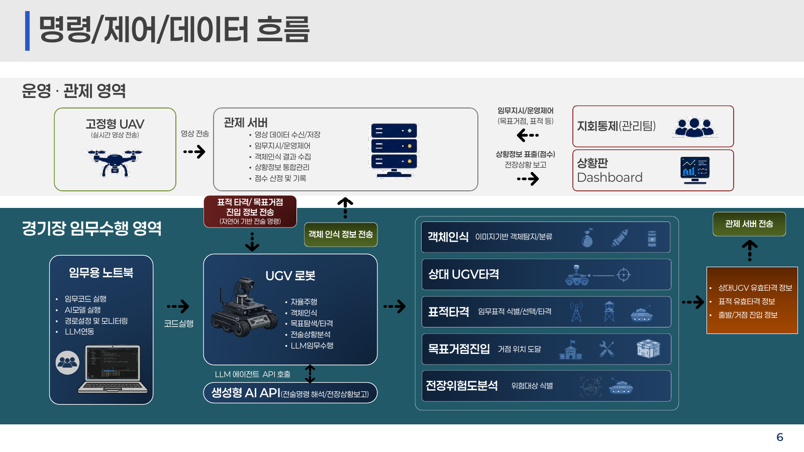
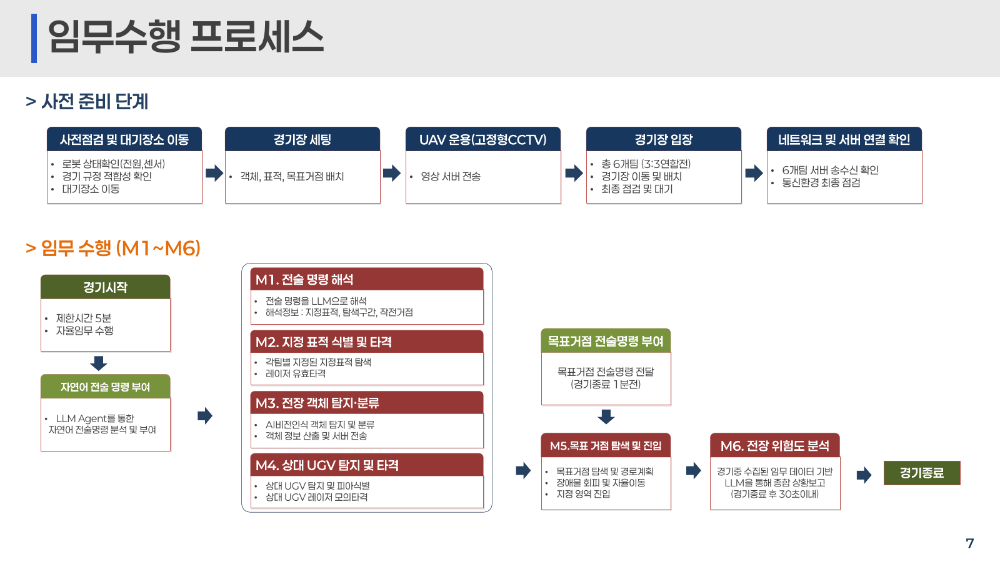
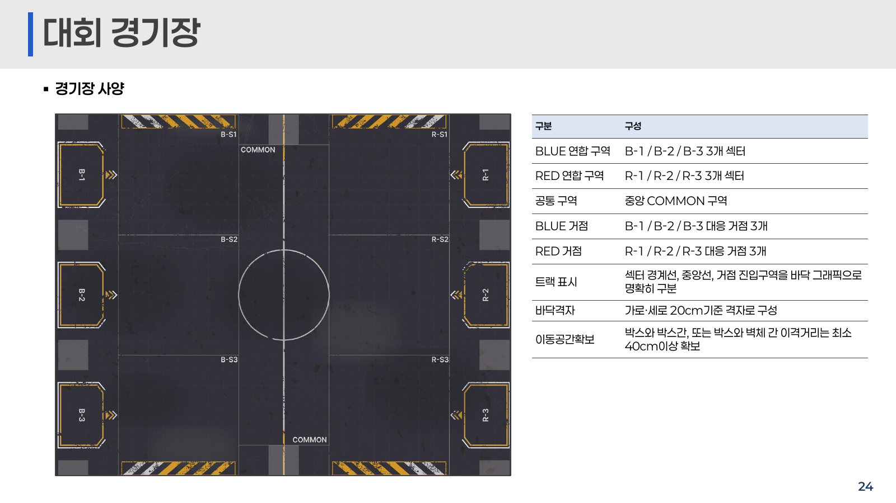

# 2026 국방 AI 경진대회 본선 1차 사전교육 — 임무내용 및 환경

원본: [prestudy(1)_2026MAICON.pdf](<../../materials/prestudy(1)_2026MAICON.pdf>) · 총 **28쪽**

첨부 PDF를 읽고 원래 쪽 순서에 따라 본문·표·예시를 Markdown으로 옮겼습니다. 도식은 주요 내용을 글로 풀고 필요한 원본 화면을 함께 수록했습니다. 장식 이미지와 AI 생성 임무 예시 이미지는 원본 PDF에서 볼 수 있습니다. 코드 블록의 인용부호와 줄바꿈은 읽을 수 있게 정리했으며, 필드명·값·수치는 원문을 따릅니다. 아래의 **변환 메모**는 원문과 구분한 설명입니다.

> 원문 고지: ※ 본 자료의 외부 공유 및 무단 복제, 배포를 금합니다.

## 1쪽 · 표지

**MAICON 2026 MILITARY AI CONTEST**

- 2026 국방 AI 경진대회 본선, 1차 사전교육 자료
- 주제: 임무내용 및 환경
- 주최: 대한민국 국방부
- 주관: 정보통신기획평가원 · 한국오픈소스협회
- 본선대회 협력업체: 주식회사 리쿠스

## 2쪽 · 본선 대회 개요

본선 대회 개요를 소개하는 구분 표지입니다.

## 3쪽 · 과제 시나리오

- **주제:** AI 기반 무인지상차량(UGV) 도심 전술 확보 작전 수행.
- **과제:** 실제 작전 수행 절차를 모사한 복합 임무를 통해 참가팀의 AI 알고리즘 및 시스템 통합 능력 검증.
- **임무 환경:** 장애물·구조물·전술 표적 모형 등이 있는 도심형 전장.
- **임무 내용:** 정찰 UAV 영상과 전술형 UGV를 연계한 복합 작전.

| 번호 | 임무 | 수행 내용 |
| --- | --- | --- |
| M1 | 전술명령 해석 | LLM으로 자연어 임무 지시를 UGV 수행 정보로 변환 |
| M2 | 지정표적 타격 | 신규 표적 정보에 맞춰 특정 시설을 식별하고 레이저 타격 |
| M3 | 전장객체 인식 | 영상으로 객체를 실시간 탐지·분류하고 통신 보고 |
| M4 | 상대 UGV 타격 | 이동하는 상대 UGV를 식별·추적하고 레이저 타격 |
| M5 | 목표거점 진입 | 스스로 경로를 계획해 제한 시간 내 상대 거점 진입 |
| M6 | 전장 위험도 분석 | 위치·탐지·교전 데이터를 종합해 전장 위험도 분석 |

## 4쪽 · 대회방식

| 구분 | 내용 |
| --- | --- |
| 참가 규모 | 총 10개 팀, 팀당 5명, 총 50명 |
| 경기 구성 | 경기당 6개 팀: BLUE 3팀 대 RED 3팀 |
| 경기시간 | 5분 |
| 전체 경기 | 총 10경기 |
| 팀별 출전 | 총 6경기, BLUE 3회 / RED 3회 |
| 경기 운영 | 시작 후 자율 임무 수행: 자율주행·객체인식·주요시설 타격·UGV 타격·상황보고 등 |
| 연속 출전 | 최대 2경기, 3경기 연속 출전 금지 |
| 상대 진영 대진 | 모든 팀 간 2회 |
| 편성 원칙 | 지연 배정 및 휴식시간 균등 편성 |
| 평가 비율 | 발표평가 20 + 임무평가 80 |
| 평가·순위 | 개별 미션 수행성과 중심, 팀 임무 수행점수 일부 반영, 경기별 획득 점수 누적 합산으로 최종 순위 결정 |

## 5쪽 · 대진표 예시

| 경기 | BLUE | RED | 대기 |
| --- | --- | --- | --- |
| 1 | 3, 4, 9 | 1, 2, 5 | 6, 7, 8, 10 |
| 2 | 1, 3, 10 | 2, 6, 8 | 4, 5, 7, 9 |
| 3 | 4, 5, 6 | 7, 9, 10 | 1, 2, 3, 8 |
| 4 | 2, 5, 9 | 1, 7, 8 | 3, 4, 6, 10 |
| 5 | 6, 8, 10 | 2, 3, 4 | 1, 5, 7, 9 |
| 6 | 4, 7, 10 | 1, 3, 9 | 2, 5, 6, 8 |
| 7 | 1, 2, 8 | 5, 6, 7 | 3, 4, 9, 10 |
| 8 | 2, 3, 6 | 4, 5, 9 | 1, 7, 8, 10 |
| 9 | 1, 7, 9 | 3, 8, 10 | 2, 4, 5, 6 |
| 10 | 5, 7, 8 | 4, 6, 10 | 1, 2, 3, 9 |

조건: 팀별 6회 출전·4회 대기, BLUE/RED 각 3회, 모든 상대와 상대 진영으로 2회 대진, 연속 출전·대기는 최대 2경기.

## 6쪽 · 명령 / 제어 / 데이터 흐름



| 영역·구성요소 | 원문에 표시된 역할 |
| --- | --- |
| 고정형 UAV | 실시간 영상 전송 |
| 관제 서버 | 영상 수신·저장, 임무지시·운영제어, 객체인식 결과 수집, 상황정보 통합관리, 점수 산정·기록 |
| 지휘통제·상황판 | 목표거점·표적 등 임무 지시, 점수·전장상황 표출, Dashboard |
| 임무용 노트북 | 임무코드 실행, AI모델 실행, 경로설정·모니터링, LLM 연동 |
| UGV 로봇 | 자율주행, 객체인식, 목표탐색·타격, 전술상황분석, LLM 임무수행 |
| LLM 에이전트 API | 생성형 AI API 호출: 전술명령 해석·전장상황보고 |
| 임무·판정 데이터 | 이미지 기반 객체탐지·분류, 상대 UGV 이동표적 탐지·추적·타격, 임무표적 식별·선택·타격, 목표거점 도달, 위험대상 식별 |
| 관제 서버에 전송하는 판정 정보 | 상대 UGV 유효타격, 표적 유효타격, 출발·거점 진입 정보 |

**변환 메모:** 이 도식의 노트북 역할 표기는 원문을 보존했습니다. 이후 2차 멘토링에서는 임무 프로그램과 LLM API 호출을 UGV 내부에서 수행한다고 설명하므로, 실제 실행 위치는 후속 자료와 최종 규정을 확인해야 합니다.

## 7쪽 · 임무수행 프로세스



사전 준비 순서는 다음과 같습니다.

1. 로봇 전원·센서 상태와 경기 규정 적합성을 확인하고 대기장소로 이동.
2. 객체·표적·목표거점 배치 등 경기장 세팅.
3. 고정형 CCTV인 UAV 운용, 영상을 서버로 전송.
4. 총 6팀이 경기장에 들어가 로봇을 배치하고 최종 점검·대기.
5. 6팀의 서버 송수신과 통신환경을 최종 점검.

경기 시작 후 제한시간 5분 동안 자율 임무를 수행합니다. 자연어 전술명령이 주어지며, M1은 LLM으로 지정표적·탐색구간·작전거점을 해석합니다. M2는 지정표적을 탐색해 유효타격하고, M3는 객체를 탐지·분류해 서버에 전송하며, M4는 상대 UGV를 탐지·피아식별하고 레이저로 타격합니다.

종료 1분 전 목표거점 전술명령이 주어집니다. M5는 거점 탐색·경로계획·장애물 회피·자율이동·지정 영역 진입입니다. M6는 경기 중 수집한 임무 데이터를 바탕으로 LLM 종합 상황보고를 경기 종료 후 30초 이내 제출합니다.

## 8쪽 · 경기 타임라인

| 시간 | 단계 | 주요 내용 | 참가팀 수행사항 | 운영 / 서버 동작 |
| --- | --- | --- | --- | --- |
| 0:00 | 경기 시작 | 자연어 전술명령과 함께 시작 | 명령 수신 후 자율 임무 시작 | 모든 UGV 동시 START, 시간 카운트 |
| 0:00~최대 5:00 | M1~M4 동시 수행 | 명령해석·지정표적·객체인식·UGV 교전 | 순차 또는 병행 수행, 결과 제출 | 임무 결과·타격·피격·객체인식·이벤트 집계 |
| 4:00 | 목표거점 전술명령 부여 | 종료 1분 전 목표거점 추가 제공 | 목표 해석, 이동 경로 계획 | 모든 팀에 목표거점 명령 전송 |
| 4:00~M5 완료 | M5 목표거점 탐색·진입 | 자율주행으로 거점 진입 | 탐색 → 경로계획 → 장애물 회피 → 진입 | 센서 판정, 자동 집계 |
| M5 완료 시점 | 본 경기 종료 | 물리적 임무 수행 종료 | 이동·조준·타격 즉시 종료 | 모든 UGV STOP, M1~M5 결과 마감 |
| 종료 후 +30초 | M6 전장 위험도 분석 | 수집 정보 기반 상황보고 | 상대 UGV 3대의 위험도 1~3순위를 JSON 제출 | 운영 서버 Ground Truth와 비교 |
| 보고 마감 | 최종 종료 | 모든 임무 종료·점수 확정 | 추가 제출 불가 | M6 마감, 최종점수 산정 |

## 9쪽 · 대회 임무 내용

구분 표지: **2026 국방 AI 경진대회 · 대회 임무 내용**. 주식회사 리쿠스, **2026.08.21** 표기.

> ※ 본 자료의 외부 공유 및 무단 복제, 배포를 금합니다.

## 10쪽 · 임무 개요

| 임무 | 핵심 능력 | 임무내용 | 평가방식 |
| --- | --- | --- | --- |
| M1 전술명령 해석 | LLM 기반 자연어 명령 이해·구조화 | 서버 명령을 UGV 수행 정보로 변환 | 지정표적·탐색구간·작전거점 정보 |
| M2 지정표적 타격 | 표적 식별·탐색·타격 | 전술명령에서 해석한 표적을 탐색·식별해 레이저 타격 | 지정표적 유효타격 |
| M3 전장객체 인식 | AI 기반 객체 탐지·분류 | 각 섹터에 임의 배치한 객체의 종류·수량을 카메라로 식별·보고 | 섹터별 종류·수량 |
| M4 상대 UGV 타격 | UGV 탐지·추적·조준 | 상대 UGV 식별·자동 추적·조준·레이저 모의타격 | UGV 유효타격 누적 |
| M5 목표거점 진입 | 자율주행·위치추정·거점 판정 | 경기 중 상대 진영 3개 거점 중 지정된 1곳으로 자율 이동 | 목표거점 선점 |
| M6 전장 위험도 분석 | LLM 기반 임무정보 종합·상황보고 | 제한된 전장 관측정보로 상대 연합의 가장 위험한 UGV 판단 | 위협도 순위 정보 |

## 11쪽 · M1 전술명령 해석

- **목적:** 자연어 전술명령을 LLM으로 해석해 수행 가능한 임무정보로 변환.
- **흐름:** 전술명령 수신 → LLM 해석 → 데이터 구조화 → JSON으로 서버 제출.
- **핵심기술:** 자연어명령이해(NLU), LLM 기반 정보추출.
- **평가:** 지정표적·탐색구간·작전거점 등의 해석 정확도. 제출 JSON 자동 판정.
- 탐색구간과 작전거점은 실제 임무용도로 쓰지 않고 **보고용**으로 사용.
- 지정표적 정보는 실제 **M2 지정표적 타격**에 사용.

자연어 전술명령 예시:

> “레이더시설를 주요 타격대상으로 지정한다. 객체 탐색은 CHARLIE와 DELTA 구역에서 수행하도록 계획하며, 후속 작전 거점은 통신중계소로 설정하라.”

원문 제출 정답 예시의 키·값:

```json
{
  "target": "RADAR_FACILITY",
  "sectors": ["CHARLIE", "DELTA"],
  "goal_base": "SUPPLY_BASE"
}
```

원문 옆 설명: 지정표적=레이더 시설, 탐색구간=B섹터·D섹터, 작전거점=통신중계소. 임무 예시 이미지는 AI 생성이라고 표시됩니다.

**변환 메모:** 이 예시는 원문 내부에서 CHARLIE/DELTA와 B·D 섹터, 통신중계소와 `SUPPLY_BASE`가 서로 일치하지 않습니다. 위 코드는 해당 불일치를 그대로 보존한 **과거 예시**입니다. [첨부 API 안내](PARTICIPANT_API_GUIDE.md#p5)의 키는 `target`, `search_sectors`, `base`이며 보고값도 다릅니다. 실제 제출용으로 위 예시를 그대로 채택하면 안 됩니다.

## 12쪽 · M2 지정표적 타격

- **목적:** 서버가 지정한 전술표적을 탐색·식별하고 레이저로 타격.
- **흐름:** 표적정보 수신 → 탐색 → 식별·조준 → 유효타격.
- **핵심기술:** AI 표적인식, 이동탐지·추적, 자동조준·레이저타격.
- **평가·판정:** 고정표적의 수광센서에 레이저가 **2초 이상 연속 감지**되면 자동 판정.
- 사전 제공 데이터와 동일한 표적 이미지 사용.
- 위치는 임의 배치하며, 정육면체 장애물 박스의 측면 한 면에 부착. 양 진영의 대칭되는 동일 위치 조건으로 배치.

| 지정표적 박스 | 사양 |
| --- | --- |
| 크기 | 400(w) × 400(d) × 400(h), 원문 단위 미표기 |
| 종류 | 감시초소, 레이더시설, 통신시설 |
| 데이터 | 클래스·사전 제공 이미지 동일 |
| 장치 | 시설 이미지 상단에 레이저 수광장치 |

배치 예시와 AI 생성 임무 예시 이미지가 포함되어 있습니다.

## 13쪽 · M3 전장객체 인식

- **목적:** 각 섹터에 배치한 객체의 종류·수량을 정확히 식별.
- **흐름:** 섹터 이동 → 객체탐지·분류 → JSON으로 서버 제출.
- **핵심기술:** AI 객체인식·분류 모델, 섹터 위치정보.
- **평가:** 섹터별 객체 종류·수량 인식 정확도.
- 위치와 수량은 섹터별 임의 배치.
- 정육면체 장애물 박스의 측면 4면에 배치, 각 면에는 객체 한 개.
- 클래스 6종은 같지만 실제 이미지는 변경될 수 있음.

| 객체인식용 장애물 박스 | 사양 |
| --- | --- |
| 크기 | 400(w) × 400(d) × 400(h), 원문 단위 미표기 |
| 종류 | 탄약상자, 드럼통, 박격포, 군용트럭, 전차, 미사일 |
| 데이터 | 클래스 동일, 실제 이미지는 상이할 수 있음 |
| 원문 추가 표기 | “객체는 정육면체” |

6종의 사진, 배치 예시, AI 생성 임무 예시 이미지가 포함되어 있습니다.

## 14쪽 · M4 상대 UGV 타격

- **목적·흐름:** 상대 UGV 탐지·식별 → 추적·조준 → 레이저 모의타격.
- **핵심기술:** AI UGV 인식, 이동탐지·추적, 자동조준·레이저타격.
- **원문 평가방식:** UGV 유효타격 누적.
- UGV 수광센서에 **2초 이상 연속 감지**되면 1회 유효피격.
- 유효피격 후 **10초 동안 레이저 발사·틸트 기능 정지**.
- 피격 후 10초 동안 추가 피격 무효(무적시간).
- 총 **4회 누적피격** 시 레이저·틸트와 함께 **주행장치까지 10초 일시정지**.
- UGV당 탄창 **8발**, 1회 발사 **5초 발광**, 재발사 대기 **5초**. 규정 출력·시간 초과 금지.
- 아군 오사도 유효피격으로 포함.
- 피격 시 LED 표시 및 상태를 서버에 자동 전송, 대시보드 실시간 집계.
- 탄창을 8bit LED로 표현. 피격 상태 색상은 파랑(정상) / 초록(1) / 노랑(2) / 주황(3) / 빨강(4).
- 외부광 오감지를 막기 위해 대회 전용 펄스 신호(변조 주파수·식별코드) 적용.

| 탄창 | 1회 발사 | 재발사 대기 | 유효타격 감지 | 기능정지 / 무적 |
| --- | --- | --- | --- | --- |
| 8발 | 5초 | 5초 | 2초 | 10초 |

**변환 메모:** 이 페이지의 평가 표현은 원문 그대로입니다. 이후 자료의 M4 배점은 [API 안내 8단계](PARTICIPANT_API_GUIDE.md#p8)에 우리 UGV의 피격 횟수별로 따로 제시되어 있습니다.

## 15쪽 · M5 목표거점 진입

- **목적:** 상대 목표거점까지 자율기동하는 능력 평가.
- 경기 종료 **1분 전**, 운영 서버가 모든 팀에 목표거점 정보를 일괄 전송한다고 설명.
- **흐름:** 목표거점 수신 → 경로계획 → 진입.
- **핵심기술:** ROS2, SLAM, Nav2 기반 자율주행.
- **평가:** 선점 성공 여부, 개별팀 및 연합 점수 부여.
- **판정:** 목표거점 6곳의 UGV 진입감지 센서로 자동 감지.
- 임무 완료와 동시에 경기가 종료되고 모든 UGV 정지.

| 목표거점 형태 | 원문 사양 |
| --- | --- |
| 데이터 | 사전 제공 |
| 크기 | 1200(w) × 400(d), 원문 단위 미표기 |
| 종류 | 작전지휘소, 정비소, 군수보급소 |
| 장치 | 광전센서(UGV 감시), LED 경광등(확인) |

원문 이미지 고지: 참고용으로 실제 대회 경기장 구성과 다를 수 있음. 사전 테스트 경기장 이미지 참조.

**변환 메모:** “일괄 전송”은 이 PDF의 표현입니다. [첨부 API 안내 9단계](PARTICIPANT_API_GUIDE.md#p9)는 참가팀이 `/target`을 요청해 받는 절차를 명시합니다.

## 16쪽 · M6 전장 위험도 분석

- **목적:** 경기 중 수집한 제한적인 관측정보로 상대 연합 UGV 중 가장 위험한 대상을 LLM으로 판단.
- **흐름:** 전장정보 수집 → 상태 추정 → LLM 종합분석 → JSON 제출.
- **핵심기술:** 전장정보융합, LLM 위협도 분석·의사결정.
- **평가:** 실제 위협도 순위와 비교해 차등 평가.
- **정답 기준:** 각 UGV의 생존점수·잔여탄약·객체인식점수로 상대 위험도 순위를 산정해 제출 결과와 비교.
- 상대 생존점수·잔여탄약·객체인식점수는 **비공개**.
- 고정정찰 UAV 영상, UGV 카메라·LiDAR, 경기 중 획득한 정보 등을 관측에 사용.
- 가장 위협적인 상대 UGV를 선정하고 JSON으로 서버 전송.

상대 진영 UGV 위험대상 분석 예시:

| 대상 | 관측 상황(예상) | LLM 판단 | 위험순위 |
| --- | --- | --- | --- |
| R-UGV-1 | 피격 3회, 발사 6회, 최근 이동량 낮음 | 생존상태 낮고 잔여탄약도 적을 가능성 | 3순위 |
| R-UGV-2 | 피격 1회, 발사 2회, 다수 섹터 이동·최근 활동 높음 | 생존상태 양호, 잔여탄약 많고 임무수행 능력 높을 것으로 추정 | 1순위 |
| R-UGV-3 | 피격 2회, 발사 4회, 일부 섹터 탐색·활동 보통 | 생존상태·탄약·임무수행도 중간으로 추정 | 2순위 |

관측상황 정보는 별도 제공하지 않으므로 참가팀이 직접 분석·추정합니다. 위 ID는 이 페이지의 예시 표기이며, 실제 제출 ID는 [API 안내 11단계](PARTICIPANT_API_GUIDE.md#p11)를 확인해야 합니다.

## 17쪽 · 임무 환경

구분 표지: **2026 국방 AI 경진대회 · 임무 환경**. 주식회사 리쿠스, **2026.08.21** 표기.

> ※ 본 자료의 외부 공유 및 무단 복제, 배포를 금합니다.

## 18쪽 · 임무 전체 환경

사진으로 다음 구성을 보여 줍니다.

- 임무 운용 노트북
- 개발 워크스테이션
- 임무용 UGV 로봇: 자율기동·객체인식·표적추적·교전
- 작전현황 대시보드(서버)
- 고정형 UAV: CCTV 실시간 영상
- 임무평가 본선 경기장
- 임무평가 테스트 경기장

## 19쪽 · 임무 운용 노트북 · 개발 워크스테이션

본선 기간 각 팀에 제공하는 장비입니다.

| 항목 | 개발 워크스테이션 | 임무 운용 노트북 |
| --- | --- | --- |
| 수량 | 팀당 1대 | 팀당 5대, 본선대회용 1대 지정 |
| CPU | Intel Core i7-13700 | Intel Core i5-1335U |
| RAM | 32GB | 16GB |
| 저장장치 | SSD 512GB | SSD 256GB |
| GPU | NVIDIA GeForce RTX 5070 | 내장 그래픽 |
| OS | Windows 11 Pro | Windows 11 Pro |

디스플레이: 팀당 24인치 모니터 2대 제공.

## 20쪽 · 대회용 로봇(UGV)

**WINGBOT-UGV**: 국방 무인전투체계를 모티브로 한 저중심·모듈형 플랫폼. AI 기반 자율주행·표적 탐지·레이저 조준에 맞춘 구조입니다.

주요 장치: Jetson Orin Nano 8G, 360도 LiDAR, Depth Camera, 6WD Wheel, ROS2, 레이저 장치, 2축 틸트.

- NVIDIA Jetson Orin Nano 기반 전용 AI 컴퓨팅
- 2축 Pan-Tilt Auto Tracking 카메라
- 레이저 발광·수광 시스템
- LiDAR 기반 자율주행
- RGB-D Depth Camera
- 6WD 고안정성 구동 플랫폼
- 모듈형 센서 확장 구조
- ROS2 기반 AI 소프트웨어 플랫폼

## 21쪽 · UGV 하드웨어 · 소프트웨어 사양

원문 사진의 부품 표기: 레이저 발광부, 2축 팬틸트, 피아식별(안테나 구조물 색상), 카메라, 2D LiDAR, 좌·우 레이저 수광센서, Depth 카메라.

| 하드웨어 항목 | 사양 |
| --- | --- |
| 메인 컴퓨팅 | NVIDIA Jetson Orin Nano 8GB |
| 저장공간 | M.2 SSD 256GB |
| 통신 | Wi-Fi 5GHz, 2.4GHz |
| 카메라 | 160도, 5MP |
| 전원장치 | UPS 모듈 |
| LiDAR | D500 Lidar 2D Mapping |
| Depth Camera | OAK Stereo Camera |
| 배터리 | 12.6V, 3S2P 6셀, 18650(25R 30Q 35E) |
| 팬틸트 | ST3215 Servo 2축, Horizontal 100도 / Vertical 30도 |
| 모터제어기 | ESP32: Motor, Pan-tilt, LED, OLED, IMU, Battery |
| 모터 | 메탈기어모터 |
| 센서 | IMU |
| 출력 | 레이저, LAMP, LED(WS2812), OLED, 스피커 |
| 무게 | 약 2.9kg |
| 크기 | 250(가로) × 230(세로) × 320(높이)mm |

| 소프트웨어 항목 | 사양 |
| --- | --- |
| OS | Ubuntu 22.04 |
| 미들웨어 | ROS2-HUMBLE-LTS, Docker 기반 |
| 언어 | Python, C++ |
| ROS 실행환경 | ROS2 Docker |
| SLAM / Mapping | Gmapping 2D, Cartographer 2D, RTAB-Map 3D |
| 웹 개발도구 | 원문: `Jypyter Lab(http://<IP>:8888` |
| API | 상태값, 모터제어, IMU, OLED, 레이저, LiDAR, 카메라 등 |

## 22쪽 · UAV(정찰 드론)

상공에 고정 배치해 전장 전체를 촬영하고 관제 서버를 통해 참가팀·운영 대시보드에 제공합니다.

| 구분 | 내용 |
| --- | --- |
| 목적 | UGV 이동·교전·객체탐색·임무수행 관측 |
| 운영 방식 | 운영 측 고정 위치·고정 시점 운용, 참가팀 직접 조종 불가 |
| 영상 제공 | UAV 촬영 → 관제 서버 → 참가팀 API |
| 기본 주기 | 1초당 1프레임(1 FPS), 임무 결과에 따라 제한 |
| 활용 | 상대 UGV 추적, 이동경로·교전상황 파악, M6 |
| 통제 | 경기·임무 조건에 따라 주기 조정 또는 일정 시간 송출 중단 |
| 대시보드 연계 | 실시간 화면·전술상황·경기기록·심판 판정 보조 |
| 공정성 | RED·BLUE에 동일한 영상 조건·제공 정책 |
| 드론 사양 | 군사목적 임무용 고정 드론, 설치 높이 약 2.5m, HD급 이상 카메라 |

모든 팀에 공통 영상을 동일 조건으로 제공합니다. 지정표적 유효타격 결과에 따른 제공 주기 예시는 다음과 같습니다.

| 지정표적 유효타격 | 영상 주기 예시 |
| --- | --- |
| 1개 | 2초당 1프레임 |
| 2개 | 5초당 1프레임 |
| 3개 모두 | 송출 중단 |

운영 측이 난이도·운영 조건에 따라 주기를 조정할 수 있습니다. 참가팀은 영상으로 UGV 위치·이동·교전·임무 상태를 분석해 M6에 활용합니다.

## 23쪽 · 대회 경기장 사양

| 항목 | 사양 |
| --- | --- |
| 크기 | 약 612cm(가로) × 500cm(세로) × 40cm(높이) |
| 구조 | 테이블, 벽체, 트랙 |
| 재질 | 프로파일, 포맥스, 실사인쇄 |
| 디자인 | 도심 복합시설 및 전술 훈련장 |
| 장애물 | 정육면체 박스 40cm × 40cm × 40cm |
| 벽면 | 높이 40cm, 프로파일 + 포맥스 |
| 진영 | RED / BLUE 각 3개 |
| 표적 | 통신시설, 레이더시설, 감시초소 등 전술 표적 모형 |
| 객체 | 탄약상자, 드럼통, 박격포, 군용트럭, 전차, 미사일 |

원문 경기장 이미지는 참고용이며 실제 경기장과 다를 수 있습니다.

## 24쪽 · 경기장 구역 · 바닥 구성



| 구분 | 구성 |
| --- | --- |
| BLUE 연합 구역 | B-1 / B-2 / B-3, 3개 섹터 |
| RED 연합 구역 | R-1 / R-2 / R-3, 3개 섹터 |
| 공통 구역 | 중앙 COMMON |
| BLUE 거점 | B-1 / B-2 / B-3 대응 3개 |
| RED 거점 | R-1 / R-2 / R-3 대응 3개 |
| 트랙 표시 | 섹터 경계선, 중앙선, 거점 진입구역을 바닥 그래픽으로 명확히 구분 |
| 바닥 격자 | 가로·세로 20cm 기준 |
| 이동공간 | 박스 간 또는 박스·벽체 간 최소 40cm 이상 |

**변환 메모:** 위 구역명은 이 PDF의 표기입니다. API 제출용 섹터명은 [API 부록](PARTICIPANT_API_GUIDE.md#p12)의 `B-S1`~`B-S3`, `R-S1`~`R-S3`, `CM`과 구분해야 합니다.

## 25쪽 · 미션 이벤트 장치

| 구분 | 장치 | 주요 기능 |
| --- | --- | --- |
| 출발·목표거점 | 광전센서 | 출발·거점 도착 비접촉 감지, 정보 서버 전송 |
| 출발·목표거점 | 3색 타워 LED | 준비·진행·완료 시각화, 각 진영 양측 2개씩 설치 |
| 출발·목표거점 | 이벤트제어장치 | 센서정보 수집, Wi-Fi 통신, UGV 식별정보·감지시각·거점정보 전송 |
| 지정표적 | 레이저 수광장치 | 전용 펄스 식별, 외부광 오감지 방지, 유효피격 자동 판정 |
| 지정표적 | 시그널 LED | 표적 상단, 유효피격 시 빨간 LED 점등, 원격 상태 제어 |
| 지정표적 | 이벤트제어장치 | 피격정보 수집, Wi-Fi 통신, 표적 ID·시각·상태 실시간 전송 |
| 환경효과 | 비인식용 박스 | 파괴건물·방호벽·야전진지·차단벽 등 전장환경 모사 장애물 |
| 환경효과 | 스모그 발생장치 | 포그머신 방식, 경기장 중앙 측면 1개소, 연기량·분출시간 조절 |
| 환경효과 | 이벤트제어장치 | 서버 연동, 원격 ON/OFF, 시간·주기 설정, 비상정지 |

테스트 경기장은 일부 이벤트 장치를 제외합니다. 원문에 출발·목표거점 센서/LED, 지정표적 시그널 LED, 비인식용 장애물, 이벤트제어장치의 사진이 있습니다.

## 26쪽 · 대시보드

각 팀 UGV 상태와 M1~M6 수행현황을 통합 모니터링하고 센서·서버·영상으로 진행·점수를 자동 집계하는 **관제 화면**입니다.

| 영역 | 주요 기능 |
| --- | --- |
| 전술 상황판 | 전체 맵, UGV 위치, 섹터·장애물·표적·목표거점 |
| UGV 상태 | 6대 생존정보·피격·잔여탄약·임무상태 |
| UAV 영상 | 고정정찰 영상, 전장상황 확인 |
| 주요 이벤트 | 명령 수신·피격·타격·거점 진입·경기상태 변경 시간순 기록 |
| 실시간 점수 | 팀별 M1~M6와 연합 누적점수 |
| 팀별 임무상태 | 진행 / 성공 / 미수행 |
| 경기 타이머 | 5분 경기시간과 잔여시간 |
| 경기 운영제어 | 시작·종료 및 운영상태 확인 |

원문 화면 예시: UGV 상태 테스트 페이지, API 테스트 페이지, 전술상황·UGV 상태, 실시간 화면·임무상태.

**변환 메모:** 관제 대시보드의 표시 항목이 참가팀 API 제공 항목이라는 뜻은 아닙니다.

## 27쪽 · 본선 대진 결정 서브게임 운영 계획

목적은 기초 자율주행·표적 탐지·조준 성능을 검증하고 수행 기록에 따라 본선 대진표 내 포지션 선택 우선권을 부여하는 것입니다. 실제 수행 결과를 본선 대진 난이도·경기운영에도 참고합니다.

UGV가 표적 반대 방향으로 틀어진 시작 위치에서 스스로 표적을 탐색·조준·타격하는 자율 임무입니다.

| 항목 | 운영기준 |
| --- | --- |
| 목적 | 본선 포지션 선택 우선순위 1~10위 결정, 본선 대진표 사전 공개 |
| 임무 | 180도 회전 상태에서 출발, 약 3m 거리 레이더 지정표적 탐색·조준·타격 |
| 성공 | 수광부에 2초 이상 연속 감지, 자동 판정 |
| 제한시간 | 1회 최대 60초 |
| 기록 시작 | 주행·회전·카메라 Pan/Tilt 등 UGV 최초 동작 시점 |
| 도전 | 팀당 2회, 별도 준비시간 없음 |
| 최종 기록 | 2회 중 가장 짧은 성공 기록 |
| 순위 | 기록이 짧은 순 |
| 무기록 | 두 번 모두 실패하면 무작위 추첨 |
| 본선 반영 | 1~10위 순서로 본선 포지션 선택 우선권 |

## 28쪽 · 맺음말

MAICON 2026 MILITARY AI CONTEST · 감사합니다.

> ※ 본 자료의 외부 공유 및 무단 복제, 배포를 금합니다.
