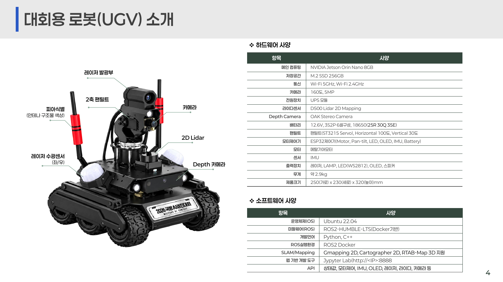
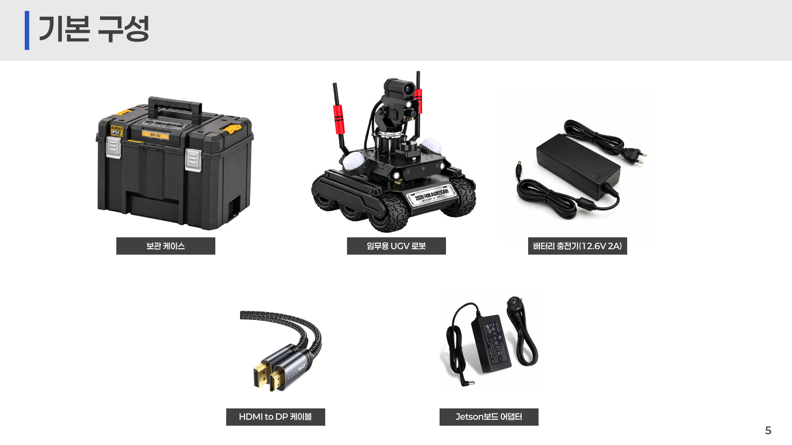

# 2026 국방 AI 경진대회 본선 2차 사전교육 — 개발운용

원본: [prestudy(2)_2026MAICON.pdf](<../../materials/prestudy(2)_2026MAICON.pdf>) · 총 **20쪽**

첨부 PDF를 읽고 원래 쪽 순서에 따라 본문·표·코드를 Markdown으로 옮겼습니다. 장식 이미지는 원본 PDF를 참고하고, 장비 구성 사진은 함께 수록했습니다. 코드의 들여쓰기와 줄바꿈을 정리했으며 원문에 없는 import나 실행 환경을 추가하지 않았습니다. 코드들은 기능별 발췌 예시입니다. **변환 메모**는 원문과 구분한 설명입니다.

> 원문 고지: ※ 본 자료의 외부 공유 및 무단 복제, 배포를 금합니다.

## 1쪽 · 표지

**MAICON 2026 MILITARY AI CONTEST**

- 2026 국방 AI 경진대회 본선, 2차 사전교육 자료
- 주제: 개발운용
- 주최: 대한민국 국방부
- 주관: 정보통신기획평가원 · 한국오픈소스협회
- 본선대회 협력업체: 주식회사 리쿠스

## 2쪽 · 개발환경

개발환경을 소개하는 구분 표지입니다.

## 3쪽 · 대회용 로봇(UGV) 소개

**WINGBOT-UGV**: 국방 무인전투체계를 모티브로 한 저중심·모듈형 플랫폼. AI 기반 자율주행·표적 탐지·레이저 조준 임무 수행에 맞춘 구조입니다.

주요 장치: Jetson Orin Nano 8G, 360도 LiDAR, Depth Camera, 6WD Wheel, ROS2, 레이저 장치, 2축 틸트.

- NVIDIA Jetson Orin Nano 기반 전용 AI 컴퓨팅
- 2축 Pan-Tilt Auto Tracking 카메라
- 레이저 발광·수광 시스템
- LiDAR 기반 자율주행
- RGB-D Depth Camera
- 6WD 고안정성 구동 플랫폼
- 모듈형 센서 확장 구조
- ROS2 기반 AI 소프트웨어 플랫폼

## 4쪽 · UGV 하드웨어 · 소프트웨어



사진의 부품 표기: 레이저 발광부, 2축 팬틸트, 안테나 구조물 색상에 의한 피아식별, 카메라, 2D LiDAR, 좌·우 레이저 수광센서, Depth 카메라.

| 하드웨어 항목 | 사양 |
| --- | --- |
| 메인 컴퓨팅 | NVIDIA Jetson Orin Nano 8GB |
| 저장공간 | M.2 SSD 256GB |
| 통신 | Wi-Fi 5GHz, Wi-Fi 2.4GHz |
| 카메라 | 160도, 5MP |
| 전원장치 | UPS 모듈 |
| LiDAR | D500 Lidar 2D Mapping |
| Depth Camera | OAK Stereo Camera |
| 배터리 | 12.6V, 3S2P 6셀, 18650(25R 30Q 35E) |
| 팬틸트 | ST3215 Servo, Horizontal 100도 / Vertical 30도 |
| 모터제어기 | ESP32: Motor, Pan-tilt, LED, OLED, IMU, Battery |
| 모터 | 메탈기어모터 |
| 센서 | IMU |
| 출력장치 | 레이저, LAMP, LED(WS2812), OLED, 스피커 |
| 무게 | 약 2.9kg |
| 크기 | 250(가로) × 230(세로) × 320(높이)mm |

| 소프트웨어 항목 | 사양 |
| --- | --- |
| OS | Ubuntu 22.04 |
| 미들웨어 | ROS2-HUMBLE-LTS, Docker 기반 |
| 언어 | Python, C++ |
| ROS 실행환경 | ROS2 Docker |
| SLAM / Mapping | Gmapping 2D, Cartographer 2D, RTAB-Map 3D |
| 웹 개발도구 | 원문: `Jypyter Lab(http://<IP>:8888` |
| API | 상태값, 모터제어, IMU, OLED, 레이저, LiDAR, 카메라 등 |

## 5쪽 · UGV 기본 구성품



- 보관 케이스
- UGV 로봇
- 전용 충전기 **12.6V / 2A**
- HDMI to DP 케이블
- Jetson Orin 전용 어댑터

## 6쪽 · 배터리 충전방법

### 충전 순서

1. **준비:** 모터 구동이 완전히 정지했는지 확인. 충전기가 **DC 12.6V / 2A**인지 확인.
2. **연결:** 지급된 충전기의 DC 커넥터를 충전 포트에 연결. 표시등으로 충전 상태 확인.
3. **진행:** 전원을 켠 채 사용할 수 있지만, **충전 케이블이 연결된 상태에서는 모터를 구동하지 않음**. Jetson·Depth 카메라가 동작하면 충전시간이 길어질 수 있으므로 빠른 충전을 위해 가급적 전원을 끄거나 불필요한 장치 사용을 중지.
4. **완료:** 충전 완료 표시와 OLED 배터리 잔량 확인.

### 배터리 기본 사양

| 항목 | 원문 표의 사양 |
| --- | --- |
| 종류 | 18650 리튬이온(Li-ion) |
| 구성 | 3S2P, 3직렬 × 2병렬 |
| 수량 | 총 6셀 |
| 전압 | 12.6V |
| 전용 충전기 | **DC 12.6V 12A** — 원문 표기, 아래 변환 메모 참조 |
| 사용시간 | 최대 소비전력 기준 약 40분 |
| 충전시간 | 100% 약 3시간 내외, 80% 약 1시간 30분 |

UGV는 **배터리 교체가 아닌 충전 방식**입니다. 준비기간·본선 중 배터리 부족에 따른 별도 교체는 불가합니다. 잔량을 수시로 확인하고 불필요한 AI 연산·Depth 카메라 사용 등 전력 소모를 줄여야 합니다. 모터·Jetson AI 연산·팬틸트 서보·Depth 카메라 사용량과 환경에 따라 운용시간은 달라집니다.

원문 주의사항:

- 대회에서 지급한 전용 충전기 **12.6V / 2A**만 사용.
- Jetson Orin 전용 어댑터는 배터리 충전용이 아니므로 충전 포트에 연결하지 않음.
- 배터리는 교체 불가. 본선 수행을 위한 전력 최적화 필요.

**변환 메모:** 이 페이지의 사양 표에는 `12A`, 충전 절차·주의사항 및 5쪽 구성품에는 `2A`로 적혀 있습니다. 원문의 불일치를 보존했으며 표의 `12A`를 새 권장 사양으로 해석한 것이 아닙니다.

## 7쪽 · 임무수행 API

참가팀은 **`team_node.py`**를 기반으로 알고리즘을 개발하고 두 종류의 API를 연계합니다.

| API | 방식 | 연결 대상·역할 |
| --- | --- | --- |
| UGV 로봇 제어 API | ROS 2 Topic / Service | UGV 제어·센서 시스템: 로봇을 움직이고 센서 수집 |
| 경기 서버 연동 API | HTTP GET / POST · JSON | 경기 운영·평가 서버: 임무를 받고 결과 보고 |

팀 프로그램이 두 API를 연결해 임무 판단·자율주행·표적 인식·결과 보고를 구현합니다.

## 8쪽 · UGV ROS2 API

UGV ROS2 API를 소개하는 구분 표지입니다.

## 9쪽 · UGV ROS2 API 구조

ROS 2 Topic·Service로 로봇 상태, 주행, 카메라 영상, 팬틸트, 레이저 발사를 제공합니다. 참가자는 공개 인터페이스로 자율주행·영상인식·표적추적 등을 구현하며 **로봇 운영 프로그램을 직접 수정할 필요가 없습니다**.

| 기능군 | 내용 |
| --- | --- |
| 상태·경기 | 배터리 / HP / 경기모드 |
| 주행·제어 | 모터 / 팬틸트 / 레이저 |
| 센서·표시 | 카메라 / IMU / OLED |

| 구분 | Topic | Service |
| --- | --- | --- |
| 방식 | 데이터 발행·구독 | 요청·응답 |
| 목적 | 센서 수신·주행 명령 | 조준·발사 명령 |
| 예 | `/mil/state`, `/cmd_vel`, `/image_raw` | `/mil/gimbal`, `/mil/fire` |
| 특징 | 지속적인 실시간 데이터 송수신 | 특정 기능 요청 후 처리 결과 확인 |

## 10쪽 · UGV ROS2 API 전체

참가팀 코드는 `rclpy`를 사용합니다. Subscribe는 수신, Publish는 송신, Pub·Sub는 송수신, Service는 요청·응답입니다.

| 기능 | Topic / Service | 방식 | 핵심 값 |
| --- | --- | --- | --- |
| 상태·경기 | `/mil/state` · `/mil/match` | Subscribe | `hp`, `hp_max`, `battery_pct`(2Hz), `mode`(practice/mission), `cmd` |
| OLED | `/mil/oled` | Publish | 4줄(0~3), 줄당 21자, 0.5초 이상 간격, 10초 뒤 기본 화면 |
| 팬틸트 | `/mil/gimbal` | Service | pan·tilt −100~100, pan +는 오른쪽, speed 1~270, acc 1~254, `ok` / `locked` |
| 주행·위치 | `/cmd_vel` · `/odom` | Pub·Sub | linear.x ±0.6m/s, angular.z ±3rad/s(+좌회전), 명령 10Hz 반복, 위치 20Hz |
| 레이저 | `/mil/fire` | Service | 1회 5초 발광, 발사 시작 10초 후 재발사, `fired` / `empty` / `locked` / `reloading` |
| 카메라 | `/image_raw` | Subscribe | 640×480 BGR, 최대 30FPS·10FPS 이하 권장, CvBridge |
| IMU | `/imu/data` | Subscribe | 자세(쿼터니언 → roll·pitch·yaw), 각속도·가속도, 20Hz |

## 11쪽 · API — 상태확인

체력·배터리·모드·경기 상태를 확인하고 상태 변화를 감시합니다.

| 필드 | 설명 |
| --- | --- |
| `hp` / `hp_max` | 현재 / 최대 체력 |
| `battery_pct` | 배터리 잔량(%) |
| `mode` | `practice`(연습) / `mission`(경기) |
| `cmd` | 경기 진행 단계 |
| `control` | 코드에서 계산하는 제어 가능 여부 |

```python
# 제어 가능 여부 판단
control = m.mode == 'practice' \
    or m.cmd in ('start', 'resume')
```

| cmd | 설명 | 경기 모드 제어 |
| --- | --- | --- |
| `idle` | 경기 없음 | 잠금 |
| `standby` | 시작 대기 | 잠금 |
| `start` | 진행 | 허용 |
| `pause` | 일시정지 | 잠금 |
| `resume` | 재개 | 허용 |
| `report` | 종료 후 보고 | 잠금 |
| `stop` | 경기 종료 | 잠금 |

- QoS: `depth=1`, `TRANSIENT_LOCAL` — 마지막 상태를 바로 받음.
- 연습 모드에는 단계별 잠금이 없지만 피격 후 잠금·재발사 대기는 적용.

출력 예:

```text
HP: 4/4 | Battery: 95%
Mode: mission | Match State: standby
Match Control: Locked
```

## 12쪽 · API — 경기모드

| 구분 | 연습 `practice` | 경기 `mission` |
| --- | --- | --- |
| 설정 | 기본 모드 | 운영 시스템이 전환 |
| 탄약·HP | 자동 회복 | 회복 없음 |
| 주행·조준·발사 | 반복 실습 가능 | `start`·`resume`에서만 |
| 대기·정지·보고 | 잠금 미적용 | 주행 무시, 조준·발사 `locked` |
| 공통 적용 | 발사 간격 10초, 피격 후 잠금, 팬틸트 범위 | 동일 |

- 참가자가 직접 모드를 바꿀 수 없음. `/mil/match`로 확인.
- 일시정지 시 레이저가 꺼지고 모터·팬틸트가 정지.
- 재개 시 자동으로 움직이지 않으므로 주행·팬틸트 명령을 다시 전송.
- OLED로 단계 확인. 연습은 `[P-MODE]`.

| 단계 흐름 | OLED 표시 | 제어 |
| --- | --- | --- |
| `idle` | — | 잠금 |
| `standby` | `[M-STBY]` | 잠금 |
| `start` | `[M-RUN]` | 허용 |
| `pause` | `[M-PAUS]` | 잠금 |
| `resume` | `[M-RUN]` | 허용 |
| `report` | `[M-REPT]` | 잠금 |
| `stop` | `[M-END]` | 잠금 |

## 13쪽 · API — OLED 제어

**`/mil/oled` — `OledLine(line, text)`**

- 4줄, `line=0~3`, 한 줄 최대 21자(영문·숫자·기호).
- 전송 간격 **0.5초 이상**.
- 마지막 출력 **10초 후** 기본 화면 복귀.
- 팀 상태·탐색 단계·시간 등 현장 디버깅에 활용.

표시 예:

```text
TEAM ALPHA
HP 4/4
BAT 95%
15:30:25 SEARCH
```

```python
pub = node.create_publisher(OledLine, '/mil/oled', 10)
pub.publish(OledLine(line=0, text='TEAM ALPHA'))
time.sleep(0.5)  # 간격 유지
```

## 14쪽 · API — 팬틸트 제어

**`/mil/gimbal` — 팬틸트 위치 제어**

| 필드 | 설명 | 범위 |
| --- | --- | --- |
| `pan` | 좌우, +오른쪽, 1단위=0.5도 | −100~100 |
| `tilt` | 상하, +위쪽, 1단위=0.15도 | −100~100 |
| `speed` | 이동 속도(도/초) | 1~270 |
| `acc` | 가속도, 권장 20 | 1~254 |

```python
req = Gimbal.Request()
req.pan, req.tilt = 0.0, 0.0
req.speed, req.acc = 80.0, 20.0
future = client.call_async(req)
rclpy.spin_until_future_complete(node, future, timeout_sec=3.0)
# → Gimbal: ok
```

| 결과 | 뜻 |
| --- | --- |
| `ok` | 명령 접수 |
| `locked` | 제어 잠금 |
| `No response` | 응답 실패·시간 초과 |

`pan`·`tilt`는 **각도가 아닌 위치값**입니다. `ok`는 목표 도착이 아니라 접수를 뜻합니다.

## 15쪽 · API — 주행

| 필드 | 설명 | 범위 |
| --- | --- | --- |
| `linear.x` | 전진(+), 후진(−) | −0.6~0.6m/s |
| `angular.z` | 좌회전(+), 우회전(−) | −3~3rad/s |
| `position.x/y` | 출발점 기준 전후·좌우 위치 | m |
| `orientation` | 방향 쿼터니언 → yaw | x, y, z, w |

위에서 본 UGV 기준으로 `linear.x +`는 앞, `angular.z +`는 좌회전, **팬틸트 `pan +`는 오른쪽**입니다.

```python
msg = Twist()
msg.linear.x = 0.15      # 전진 0.15 m/s
msg.angular.z = 0.0
for _ in range(10):     # 10Hz × 1초
    pub.publish(msg)
    time.sleep(0.1)
pub.publish(Twist())    # 정지

# Position: X=0.012m, Y=0.001m | Yaw=1.8deg
```

원문 주행 안전 안내:

- 속도 명령 약 **10Hz** 반복. **0.5초 끊기면 자동 정지**.
- 여러 노드에서 `/cmd_vel` 동시 전송 금지(명령 충돌).
- 충전 케이블을 분리한 뒤 안전한 장소에서 저속 시험.
- `/odom`은 **20Hz**, `qos_profile_sensor_data` 사용.

## 16쪽 · API — 레이저 발사

파라미터 없이 **`Fire.Request()`**를 보냅니다. 1회 **5초 발광**, 발사 시작 **10초 후 재발사** 가능합니다. 응답의 `left_ms`로 남은 대기를 확인합니다.

```python
future = client.call_async(Fire.Request())
rclpy.spin_until_future_complete(node, future, timeout_sec=3.0)
result = future.result()
print('Fire:', result.message)       # fired
print('Remaining:', result.left_ms)  # 10000 ms
```

| message | 설명 |
| --- | --- |
| `fired` | 발사 성공 |
| `empty` | 탄약 없음 |
| `locked` | 대기·일시정지·보고·종료 또는 피격 후 10초 잠금 |
| `reloading` | 재장전 대기 |

- 경기 모드에서는 탄약·HP가 회복되지 않으므로 발사 타이밍 최적화 필요.
- 피격 시 조준·발사 10초 제한.
- **HP 0이라도 탄약이 있고 다른 제한이 없으면 발사 가능**.
- 일시정지 시 레이저가 꺼지며 재개 뒤 명령을 다시 전송.
- 발사 주기: 0초 발사 → 5초 레이저 꺼짐 → 10초 재발사 가능.

원문 레이저 안전 안내: 눈에 직접 노출되면 시력 손상 위험이 있으므로 주변을 확인하고 눈 방향으로 발사하지 않습니다.

## 17쪽 · API — 카메라 · IMU

### 카메라 `/image_raw` — `sensor_msgs/Image`

- **640×480, BGR(OpenCV), 최대 30FPS**. CPU 부담 때문에 **10FPS 이하 권장**.
- `CvBridge().imgmsg_to_cv2(msg, 'bgr8')`로 NumPy 배열 변환.
- 팬틸트 카메라 영상이며 **Depth 카메라는 이 토픽이 아님**.
- OpenCV·AI 객체 인식(M3)에 활용.

```python
sub = node.create_subscription(
    Image, '/image_raw', data.append,
    qos_profile_sensor_data)
frame = CvBridge().imgmsg_to_cv2(data[-1], 'bgr8')
print('Camera:', frame.shape)  # (480, 640, 3)
```

### IMU `/imu/data`

원문 소제목: `08 · /imu/data — sensor_msgs/`

**변환 메모:** 원문 소제목의 메시지 타입은 `sensor_msgs/`까지만 표시되어 있습니다. 누락된 타입명을 추정해서 채우지 않았습니다.

| 데이터 | 활용 |
| --- | --- |
| roll / pitch(도) | 로봇 기울기 |
| yaw(도) | 진행 방향 |
| `linear_acceleration` | 급격한 움직임·충격 |
| `/odom position` | 이동 거리·현재 위치 추정 |

```python
yaw = math.degrees(math.atan2(
    2*(q.w*q.z + q.x*q.y), 1 - 2*(q.y*q.y + q.z*q.z)))
g = math.sqrt(a.x**2 + a.y**2 + a.z**2) / 9.80665
# Roll: 0.2 | Pitch: -0.2 | Yaw: -34.5 | Acc: 1.01g
```

기울기·충격을 감지하면 `/cmd_vel`에 `Twist()`(속도 0)를 전송해 즉시 정지합니다.

## 18쪽 · 팀 노드(`team_node.py`) 수행 기준

| 항목 | 내용 |
| --- | --- |
| 코드 경로 | `~/team/team_node.py` |
| 실행 시점 | 경기 시작 대기(`standby`)에 운영 프로그램이 자동 실행 |
| 실행 형태 | Python ROS 2 노드, 하위 프로그램은 팀 노드가 실행·관리 |
| 경기 상태 | `/mil/match` 구독 |
| 경기 종료 | `report` 후 `stop` 수신 시 팀 노드 종료 |
| 오류 | 비정상 종료 시 경기당 최대 3회 자동 재실행 |
| 성능 | `step()` 0.1초 이내, AI 추론은 별도 스레드 |

원문 구현 체크리스트:

1. `/mil/match`를 구독하고 `mode`·`cmd`로 제어 가능 여부 판단.
2. `/mil/state`로 HP·배터리 감시.
3. 주행 명령 10Hz 반복, 종료·예외 때 `Twist()`로 정지.
4. 팬틸트 `pan`(+오른쪽)과 주행 `angular.z`(+왼쪽)의 방향 확인.
5. `fired`, `reloading`, `locked`, `empty` 응답 처리.
6. 카메라 10FPS 이하, 별도 스레드에서 추론.
7. `resume` 후 주행·팬틸트 명령 재전송.
8. OLED로 팀 상태를 표시해 현장 디버깅.
9. 연습 모드에서 전 기능 시험 후 `~/team/`에 저장.

## 19쪽 · 경기 서버 연동 API(HTTP)

경기 서버 연동 API를 소개하는 구분 표지입니다. 원문은 별도로 첨부한 **경기 서버 연동 API.html** 자료를 참조하도록 안내합니다.

이 저장소의 별도 첨부자료: [참가팀 단계별 API 안내 — Markdown](PARTICIPANT_API_GUIDE.md) · [원본 HTML](<../../materials/참가팀 단계별 API 안내.html>)

## 20쪽 · 맺음말

MAICON 2026 MILITARY AI CONTEST · 감사합니다.

> ※ 본 자료의 외부 공유 및 무단 복제, 배포를 금합니다.
